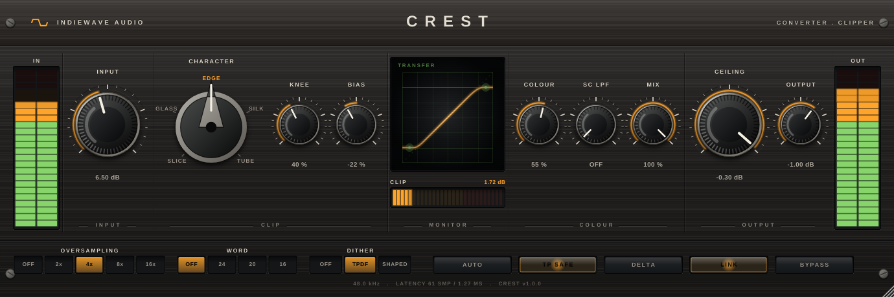

# CREST — IndieWave Audio

A converter and clipper. Drive a signal into a ceiling it cannot cross, choose
how the corner is rounded, and optionally run the result through a converter
style output stage with word length, dither and noise shaping.



Built with JUCE 8. Ships as **VST3** and **Standalone** on Windows, macOS and
Linux, plus **AU** on macOS.

---

## What it does

A clipper trades crest factor for level: it removes the tips of the peaks so the
whole signal can sit higher without the peaks going over. The two things that
decide whether that sounds like loudness or like damage are *where* the ceiling
sits and *how* the transfer curve turns the corner. Crest gives you both, and
shows you the curve you are actually using.

Around that sits the part most clippers leave out: the stage a converter would
have added anyway. A little level dependent softening on the way in, and a real
quantiser with dither on the way out.

### Signal flow

```
in ─┬──────────────────────────── dry (delay matched to the wet path) ──┐
    │                                                                   │
    └─ input trim ─ ÷ceiling ─┬─ upsample ─ colour ─ shaper ─┬─ downsample ┴─ mix ─ output trim ─ quantiser ─ out
                              │                      ▲       │
                              │            character · knee · bias
                              │                              └─ SC LPF ─┐
                              │                                  (x − shaper(x))
                              └─ stereo link: one gain from the louder channel
```

Everything between the input trim and the downsampler runs in a normalised
domain where **1.0 is the ceiling**, which is what makes the ceiling exact: the
shaper cannot produce a value above 1.0 by construction, at any setting.

---

## Controls

### Gain staging

| Control | Range | What it does |
| --- | --- | --- |
| **Input** | −12 … +30 dB | How hard the signal is driven into the ceiling. This is the amount of clipping. |
| **Ceiling** | −24 … 0 dBFS | The level the output is not allowed to cross. |
| **Output** | −24 … +12 dB | Final trim, after the mix. |
| **Mix** | 0 … 100 % | Parallel clipping. The dry path is delay matched, so this nulls properly. |

### Character

| Control | What it does |
| --- | --- |
| **SLICE** | True hard clip. Instant corner, widest harmonic spread. |
| **GLASS** | Sine knee. Short corner, bright. |
| **EDGE** | Cubic knee. Reaches the ceiling at a finite level, so it still clips flat. |
| **SILK** | Tanh knee. Smooth and asymptotic, closer to compression. |
| **TUBE** | Arctan knee. The slowest corner, weighted towards low order harmonics. |
| **Knee** | 0 % is a hard corner for every character. At 100 % the knee opens down to a quarter of the ceiling. |
| **Bias** | Moves the positive and negative thresholds apart. This is the even harmonic control. |
| **Colour** | The analogue input stage: level dependent treble softening and a small asymmetric non‑linearity. At 100 % the softening tops out around −1.5 dB at 20 kHz. |
| **SC LPF** | Off, or 20 Hz … 800 Hz. Hands the low frequency part of the clipping back, so the bass keeps its shape while everything above the cutoff still clips. See below. |

Below the knee threshold the gain is exactly 1.0 — not approximately. Every
character keeps that guarantee, and the offline checks assert it.

### SC LPF

Clipping a full mix flattens whatever dominates the peaks, and that is almost
always the low end. The result is intermodulation against everything above it:
the bass loses weight and the mids pump in time with it.

Rather than splitting the signal before the clipper, Crest filters what the
clipper *removes* and gives the low part of it back:

```
out = shaper(x) + LPF(x − shaper(x))
```

Mathematically this is the same as a band split, with one property that matters:
when nothing is being clipped, `x − shaper(x)` is exactly zero, so the filter
adds exactly zero — at any cutoff. Transparency below the ceiling is untouched
by this control, which the offline checks assert at four cutoffs.

**It trades against the ceiling, by design.** Handing low frequency material
back raises the peak, so with the sidechain open the sum can climb past where
the shaper would have held it. What happens then depends on TP Safe:

| | Result |
| --- | --- |
| **TP SAFE on** | The ceiling stays absolute. The sidechain gives back only what fits underneath it, so the harder you drive, the less the low end can escape. |
| **TP SAFE off** | The low end comes back in full. The shaper still limits everything it processes, but the restored low band may exceed the ceiling. |

Measured, at 48 kHz on a 59 Hz tone sharing the signal with a 2 kHz tone, hard
clip, showing how much level the bass loses:

| Drive | SC off | 120 Hz | 400 Hz |
| --- | --- | --- | --- |
| 3 dB | −0.07 dB | −0.02 dB | −0.01 dB |
| 6 dB, TP Safe on | −1.17 dB | −0.65 dB | −0.55 dB |
| 6 dB, TP Safe off | −1.16 dB | −0.28 dB | −0.02 dB |
| 12 dB, TP Safe on | −5.30 dB | −4.75 dB | −4.72 dB |
| 12 dB, TP Safe off | −5.29 dB | −0.70 dB | −0.05 dB |

The clip meter says `SC AT CEILING` when the sidechain is being limited by the
ceiling clamp, so the trade is visible rather than something to discover.

### Converter

| Control | What it does |
| --- | --- |
| **OS** | Oversampling: off, 2x, 4x, 8x, 16x. Linear phase half band FIR, with the passband loss measured and compensated at load, so switching factors does not change the level. |
| **WORD** | Output word length: off, 24, 20 or 16 bit. |
| **DITHER** | Off, TPDF, or TPDF with second order noise shaping. |

### Switches

| Switch | What it does |
| --- | --- |
| **AUTO** | Level matches the output against the input trim, for A/B without a loudness bias. |
| **TP SAFE** | Catches the overshoot the downsampling filter can ring past the ceiling. Leave it on unless you are measuring the filter. |
| **DELTA** | Monitors wet minus dry: only the material the clipper is removing. Silent when nothing is being clipped. |
| **LINK** | Derives one gain from the louder of the two channels and applies it to both, so hard panned peaks are not pulled toward the centre. |
| **BYPASS** | Latency compensated, so bypassing does not shift the signal in time. |

---

## Measured behaviour

From `crest_tests`, at 48 kHz. The same numbers come out of the Linux build
and the macOS universal build, which is checked in CI on every push:

| Oversampling | Latency | Gain error below the ceiling | THD+N below the ceiling |
| --- | --- | --- | --- |
| off | 0 smp | 0.0000 dB | −153.6 dB |
| 2x | 49 smp | 0.0001 dB | −145.3 dB |
| 4x | 61 smp | 0.0001 dB | −143.4 dB |
| 8x | 65 smp | 0.0001 dB | −143.0 dB |
| 16x | 67 smp | 0.0001 dB | −142.9 dB |

The ceiling is held at every oversampling factor with the input driven 24 dB
into it, at ceilings from 0 to −12 dBFS.

---

## Downloads

There is no download link until a build has run. Two ways to get one:

**Every push builds macOS.** The `macOS` workflow builds a universal
(arm64 + x86_64) VST3, AU and standalone on every push, runs the offline
checks, and uploads an installable zip. Open the run under the repository's
**Actions** tab and download `Crest-macOS-universal` from the artifact list at
the bottom. Run artifacts expire after 90 days and can only be downloaded by
someone signed in to GitHub with access to the repository.

**Tag a version for a public release.** Pushing a `v*` tag attaches the same
zip to a GitHub release, which anyone can download without an account:

```bash
git tag v1.0.0 && git push origin v1.0.0
```

### Installing on macOS

```
Crest.vst3       ->  ~/Library/Audio/Plug-Ins/VST3/
Crest.component  ->  ~/Library/Audio/Plug-Ins/Components/
```

Logic and GarageBand cache their plugin scan, so after installing the AU:
`killall -9 AudioComponentRegistrar`, then reopen the host.

### Signing

Without signing secrets the workflow signs ad-hoc. That is enough to load the
plugin on the machine that built it, but macOS quarantines anything downloaded
from the internet and an ad-hoc signature does not clear that — whoever
installs it has to run `xattr -dr com.apple.quarantine` on the bundles first.
The workflow ships a note in the zip saying so.

To ship something that installs without that step, add three repository
secrets and the workflow signs with the hardened runtime instead:

| Secret | What it is |
| --- | --- |
| `MACOS_CERTIFICATE` | Developer ID Application certificate, exported as `.p12` and base64 encoded |
| `MACOS_CERTIFICATE_PASSWORD` | The password set when exporting the `.p12` |
| `MACOS_SIGNING_IDENTITY` | e.g. `Developer ID Application: Your Name (TEAMID)` |

That needs an Apple Developer account. Notarisation — Apple's server side
scan, which is what finally silences Gatekeeper for a downloaded plugin — is a
further step on top of signing and is not wired up yet.

## Building

Requires CMake 3.22+ and a C++20 compiler.

```bash
# JUCE is fetched automatically...
cmake -B build -DCMAKE_BUILD_TYPE=Release
# ...or point at a local checkout
cmake -B build -DCMAKE_BUILD_TYPE=Release -DJUCE_PATH=/path/to/JUCE

cmake --build build --parallel
```

The VST3 lands in `build/Crest_artefacts/Release/VST3/Crest.vst3`.

On Linux, JUCE needs the usual development headers:

```bash
sudo apt install libx11-dev libxext-dev libxrandr-dev libxinerama-dev \
                 libxcursor-dev libfreetype-dev libfontconfig1-dev \
                 libasound2-dev libcurl4-openssl-dev
```

### Offline checks

```bash
cmake -B build -DCREST_BUILD_TESTS=ON
cmake --build build --target crest_tests --parallel
./build/crest_tests_artefacts/Release/crest_tests
```

These assert the properties that break silently: the ceiling holding at every
setting, transparency below the knee, latency matching what the plugin reports
to the host, sample aligned bypass, a silent delta below the ceiling, finite
output across sample rates and block sizes, and state surviving a save.

### Editor snapshot

Layout regressions do not fail a compile, so the editor can be painted to a PNG
without opening a window:

```bash
cmake -B build -DCREST_BUILD_TOOLS=ON
cmake --build build --target crest_shot --parallel
./build/crest_shot_artefacts/Release/crest_shot docs/ui.png 880
```

---

## Layout of the source

```
src/dsp/Shaper.h        the five transfer curves, shared by the DSP and the curve display
src/dsp/ColorStage.h    the analogue input stage and the DC blocker
src/dsp/Quantizer.h     word length, dither, noise shaping
src/dsp/Meters.h        lock free metering between the audio thread and the editor
src/PluginProcessor.*   parameters, gain staging, oversampling, the audio chain
src/dsp/LowSplit.h      the sidechain low pass
src/gui/Hardware.*      the panel: brushed metal, machined knobs, lamps, ladders, scope
src/PluginEditor.*      layout, scaled as a whole from one design size
tests/Tests.cpp         the offline checks
tools/Snapshot.cpp      offscreen editor render
```

The curve display and the audio thread call the same `Shaper`, so the picture
cannot drift away from what you are hearing.

---

## Originality

Crest is an independent implementation. The transfer curves, the colour and
quantiser stages, the gain staging, the metering and the entire interface were
written for this project. No code, DSP model, graphics, preset data or interface
element was taken from, decompiled from, or derived from any other product.

Converter emulation and clipping are categories of audio processing, not
protected designs — but a specific implementation of one is protected, so the
implementation here is its own.

## Licence

See `LICENSE`. JUCE and the VST3 SDK carry their own terms, and those terms
decide how you are allowed to distribute a build — read `NOTICE.md` before you
ship a binary.
