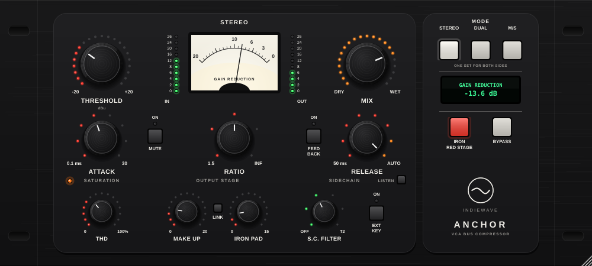

# ANCHOR — IndieWave Audio

A stereo VCA bus compressor, modelled on a well known two channel hardware
unit with digital recall from the same maker as the vari-mu Beacon follows,
after that unit's user manual, and dressed to sit beside Beacon in a rack:
black panels, knurled knobs in rings of LEDs, a moving coil meter between
level ladders. Stepped ratio, attack and release with AUTO, sidechain high
passes and two tilt curves, an external key, THD on the wet path, parallel
mix, and a choice of output: RED (transformer and IRON PAD) or GREEN
(clean), each with its own make up gain.



Built with JUCE 8. Ships as **VST3** and **Standalone** on Windows, macOS and
Linux, plus **AU** on macOS.

---

## Signal flow

Following the block diagram in the hardware's manual:

```
in ─┬─ [M/S encode] ─┬─ THD ─ VCA ──────────────────┬─ mix ─ make up ─ mute ─ [M/S decode] ─┬─ GREEN ──────────┬─ out
    │                │         ▲                    │   ▲                                   └─ RED: iron ─ PAD ┘
    │                │   ballistics ◄ curve ◄ SC filter ◄─ FF: the cell's input, or the EXT key
    │                │                               ◄─ FB: the cell's output (the feedback adapter)
    │                └──────────────── dry ──────────────┘
    └─ bypass: delay matched, so switching out is the input exactly
```

Everything after the bypass split runs at 4x.

## Controls

| Control | Range | What it does |
| --- | --- | --- |
| **Threshold** | −20 … +20 dBu | Where the corner sits. 0 dBu is −18 dBFS. |
| **Ratio** | 1.5, 2, 4, 10:1, INF | Stepped. INF is a limiter. |
| **Attack** | 0.1, 0.3, 1, 3, 5, 10, 15, 30 ms | Stepped, the eight positions of the front panel. |
| **Release** | 0.05, 0.1, 0.3, 0.5, 0.6, 0.9, 1.2 s, AUTO | Stepped. AUTO is program dependent, see below. |
| **S.C. FILTER** | OFF, 60, 90, 150 Hz, T1, T2 | What the detector hears. The high passes are 6 dB/oct; T1 and T2 are tilts with a high pass and a high boost. |
| **EXT KEY** | | The detectors listen to the plugin's sidechain input instead of the programme, through the S.C. filter. Without a key connected it does nothing. |
| **FEED BACK** | | The hardware is feed-forward; its optional feedback adapter, a Y-cable from the output into the key input, makes it feedback. This is that adapter, built in, and it also works in mid/side, where the cable does not. |
| **LISTEN** | | Plays the sidechain, filter included. |
| **THD** | 0 … 100 % | The saturation stage, on the wet path only, ahead of the VCA. 0 takes it out. The manual's knob reads 0 to 100 % and its specification gives 0 to 8 % of distortion; here 100 % is 8 % at +4 dBu, 50 % is 2 %, 25 % is 0.5 %. |
| **Mix** | 0 … 100 % | Parallel compression, sample aligned. |
| **MAKE UP** | 0 … 20 dB, 0.25 dB steps | After the mix. One knob with two values, as on the unit: green LEDs for GREEN, red LEDs for RED, where it is also what drives the iron. |
| **MUTE** | | Silences the channel; in mid/side, the mid or the side. |
| **IRON** | | RED: output transformer and PAD. Off: GREEN, electronically balanced, clean. |
| **IRON PAD** + **LINK** | 0 … 15 dB, 1 dB steps | Passive attenuator after the iron, RED only; the link moves it with the RED make up. |
| **BYPASS** | | The host's bypass, on the panel. |

**Mode**, as on Beacon: **Stereo** links the two detectors so the image
cannot shift; **Dual Mono** gives each channel its own detector, and the tab
at the edge (**SPLIT L/R**) folds out a right panel with its own settings;
**Mid/Side** compresses mid and side separately, each with its own panel.
IRON, PAD, its link and EXT KEY are single, on the first panel; the output
transformers work in left/right, outside the M/S matrix, as the manual
describes.

### AUTO release

Two recoveries in parallel: a fast one (80 ms) for what a transient took, and
a slow one (1.6 s) that charges only from material held for a while (0.35 s).
The cell takes whichever asks for more. From the checks: after a 20 ms burst
the reduction is half way back in 56 ms; after 3 s of the same tone it takes
722 ms.

### Measured (from `anchor_tests`, 48 kHz)

| | |
| --- | --- |
| 20 dB over the threshold, FF: 1.5 / 2 / 4 / 10 / INF | 6.6 / 9.9 / 14.9 / 17.8 / 19.8 dB of reduction |
| Same, FB | 6.6 / 9.9 / 14.9 / 17.9 / 20.0 dB |
| Attack to half way, 0.1 … 30 ms | 1, 1, 2, 4, 6, 10, 15, 29 ms |
| Release to half way, 0.05 … 1.2 s | 36, 70, 209, 347, 415, 615, 789 ms |
| THD+N at rest, +4 dBu, GREEN | 0.0004 % (specified: < 0.006 % at 0 dBu) |
| Same, with 7.5 dB of reduction | 0.06 % |
| THD knob 25 / 50 / 100 % at +4 dBu | 0.50 / 2.00 / 8.00 % |
| 40 Hz, 20 dB over: S.C. filter off / 150 Hz | 13.6 / 5.1 dB of reduction |
| Latency | 61 samples at every rate |

## What it is, and what it is not

**From the hardware's user manual:** the ratio, attack and release
positions; the sidechain filter positions and slopes, and that T1 and T2
are tilts with a high pass and a high boost; the external key, with the
filters still in its path; feed-forward detection and the feedback adapter;
THD on the wet path only, 0 to 100 % on the knob and 0 to 8 % in the
specification, bypassed at 0; the parallel mix; make up of 0 to 20 dB in
0.25 dB steps with a value for each output stage; the RED output with
transformer, IRON PAD of 0 to 15 dB in 1 dB steps and its link, and the
clean GREEN output; per channel mute; stereo, dual mono and mid/side, with
the output transformers outside the M/S matrix; the 0 to 20 dB gain
reduction meter and 0 to 26 dBu level meters.

**This project's own choices,** because no hardware was measured and the
manual does not give them: the threshold range and level reference (0 dBu =
−18 dBFS); the 4 dB soft corner; the exact curves of T1 (90 Hz high pass
with +3 dB above 3 kHz) and T2 (150 Hz with +6 dB above 5 kHz); how AUTO
behaves inside; the law between the THD knob and the distortion; the trace
of second harmonic the VCA adds as it works; the feedback mode's capped loop
gain at INF. All are constants at the top of `src/dsp/Vca.h`,
`src/PluginProcessor.h`, `src/dsp/Tube.h` and `src/dsp/OutputStage.h`.

Left out: the unit's relative parameter link (the split panel and its copy
on splitting do that job here), and its A/B/C memories and preset banks (a
DAW does that). The interface is an original design in the IndieWave style;
no name, logo or panel artwork of any other product is used.

## Building

Requires CMake 3.22+ and a C++20 compiler.

```bash
cd plugins/anchor
cmake -B build -DCMAKE_BUILD_TYPE=Release          # fetches JUCE 8.0.6
cmake --build build --parallel
```

On Linux, JUCE needs the usual development headers (see the Crest README).

### Offline checks and snapshot

```bash
cmake -B build -DANCHOR_BUILD_TESTS=ON -DANCHOR_BUILD_TOOLS=ON
cmake --build build --target anchor_tests anchor_shot --parallel
./build/anchor_tests_artefacts/Release/anchor_tests
./build/anchor_shot_artefacts/Release/anchor_shot docs/ui.png 1.0 stereo   # or dual, ms
```

The checks assert: the static curve for every ratio in both detector modes;
silence below the threshold; a flat, clean idle; attack and release that
scale with every position of their switches; AUTO letting a transient go quickly and sustained
material slowly; every sidechain filter position against its response, by
listening; the high pass keeping bass from pumping; the external key, and
falling back to the programme without one; the THD calibration and THD on the
wet path only; the iron driven harder at the same level, and the PAD and RED make up inert
in GREEN; each output stage's own make up; mute, and muting only the side in
mid/side; bypass and dry mix; stereo linking, the mid/side matrix, the side's
own controls, the iron in left/right; dual mono split; latency; feedback at
INF settling; finite output at extreme settings across rates and block
sizes; state; and that sessions saved by released versions (`tests/compat/`)
open unchanged.

## Source

```
src/dsp/Vca.h           ratio law, ballistics and AUTO, the VCA, sidechain filter
src/dsp/Tube.h          triode curve, THD calibration, level reference (as Beacon)
src/dsp/OutputStage.h   transformer, tube line amp, RED/GREEN, iron pad (as Beacon)
src/dsp/Meters.h        audio thread to editor
src/PluginProcessor.*   parameters, channel modes, sidechain bus, oversampling, the signal path
src/PluginEditor.*      the panel, make up per stage, iron link, folding
tests/Tests.cpp         the offline checks
tools/Snapshot.cpp      offscreen editor render
```

## Licence

As for the rest of this repository; see `../../LICENSE` and `../../NOTICE.md`.
