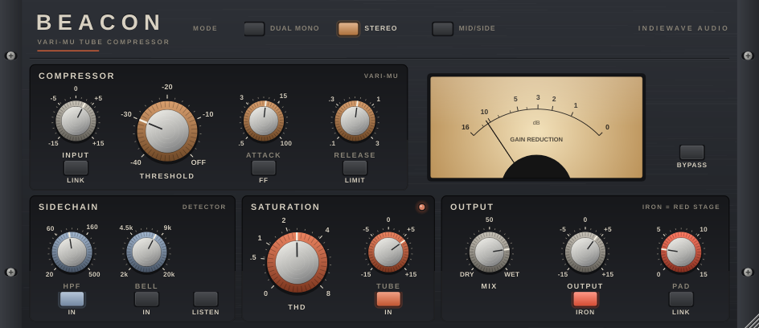

# BEACON — IndieWave Audio

A stereo variable-mu tube compressor, modelled on a well known two channel
hardware unit with digital recall. No ratio knob: like the hardware, the ratio is a property of level,
gentle at the threshold and steepening as the signal goes past it. Around the
vari-mu tube sit input transformers, a calibrated THD stage, a TUBE drive
control, and a choice of output: RED (tube amplifier, transformer and IRON PAD)
or GREEN (clean).



Built with JUCE 8. Ships as **VST3** and **Standalone** on Windows, macOS and
Linux, plus **AU** on macOS.

---

## Signal flow

Following the block descriptions in the hardware's user manual:

```
in ─┬─ [M/S encode] ─ input ─ input iron ─┬─ THD ─ vari-mu tube ──┬─ mix ─ output ─ [M/S decode] ─┬─ GREEN ───────────────┬─ out
    │                                     │          ▲    (TUBE)  │   ▲                            └─ RED: tube ─ iron ─ PAD┘
    │                                     │   law ◄ envelope ◄ rectifier ◄ SC HPF / high bell     │   │
    │                                     │          FF: from the cell's input ┘  ▲                │   │
    │                                     │          FB: from the cell's output ──┘                │   │
    │                                     └───────────────────── dry ─────────────────────────────┴───┘
    └─ bypass: delay matched, so switching out is the input exactly
```

Everything from the input trim to the output stage runs at 4x.

## Controls

One set of controls drives both channels:

| Control | Range | What it does |
| --- | --- | --- |
| **Input** | ±15 dB, 0.25 dB steps | Level into the unit: the input transformer, THD, tube and compressor all see it. |
| **LINK** | | Dynamic link: turning Input or Threshold moves the other the same way and Output the opposite way, so the drive changes and the level does not. |
| **Threshold** | −40 … 0 dB, **0 = off** | Below the +26 dBu ceiling. Fully clockwise the compressor does nothing, as on the unit. |
| **Attack** | 0.5 … 100 ms | Rectifier timing capacitor, charge. |
| **Release** | 0.1 … 3 s | Rectifier timing capacitor, discharge. |
| **FF** | | Off: feedbackward, the detector listens to the tube's output (the classic vari-mu, and the unit's default). On: feed-forward, it listens to its input, through a curve that makes vari-mu behave there (no negative compression). |
| **LIMIT** | | A steeper law, in either mode: about 3:1 at the threshold, past 8:1 well over it. |
| **HPF** + **IN** | 20 … 500 Hz | Sidechain high pass, 6 dB/oct, switchable. |
| **BELL** + **IN** | 2 … 20 kHz | Sidechain high bell boost, +6 dB, switchable. |
| **LISTEN** | | Plays the sidechain signal, filters included. |
| **THD** | 0 … 8 % | First saturation stage, ahead of the compressor. Calibrated (see below); 0 is out of circuit. |
| **TUBE** + **IN** | ±15 dB | Drive into the vari-mu tube. Made up again after it, and the detector is compensated, so the compression does not change. The tube is always in the path; IN takes its saturation out. |
| **Mix** | 0 … 100 % | Parallel compression, sample aligned. The dry half is taken after the input transformer. |
| **Output** | ±15 dB, 0.25 dB steps | After the mix. In RED mode it is also what drives the tube and the iron. |
| **IRON** | | RED: tube amplifier, output transformer and PAD. Off: GREEN, electronically balanced, clean. |
| **PAD** | 0 … 15 dB, 1 dB steps | IRON PAD: a passive attenuator at the very end, RED only, after the mix. |
| **LINK** (output) | | Iron link: Output and PAD move together, so the iron is driven harder at the same level. |
| **BYPASS** | | The host's bypass, on the panel. |

**Mode** sets what the detectors listen to; the settings are the same in all
three. **Stereo** (the default): one detector for both channels, so the image
cannot shift. **Dual Mono**: each channel compresses on its own detector, which
the hardware's manual calls its most common use on a stereo source.
**Mid/Side**: mid and side each compress on their own detector, each with
its own settings: an **EDIT MID | SIDE** switch appears beside the meter and
turns the panel over to the other half, the section headings say which half is
on show, and the meter follows it. The main settings are the mid's. IRON, PAD
and the iron link stay single, because the output transformers work in
left/right, outside the M/S matrix, as on the unit. For different settings per
channel outside mid/side, use two instances on mono tracks.

The moving coil gain reduction meter reads 0 to 16 dB like the unit's, and
shows whichever channel is being reduced more (in mid/side, the half on show). A heater lamp in the
SATURATION section glows as THD is driven.

## How it is modelled

**The gain law.** A vari-mu has no ratio control: a remote cutoff tube's gain
falls faster the further its grid is pushed negative. With *e* the rectified
level's excess over the threshold, as a fraction of it,

```
GR (dB) = K · (e + c · e²)
```

which in the feedback loop gives the soft knee and rising ratio the manual
describes. Measured (1 kHz, threshold −30 dBFS, from `beacon_tests`):

| Input over threshold | 3 dB | 9 dB | 15 dB | 24 dB | 30 dB |
| --- | --- | --- | --- | --- | --- |
| Gain reduction | 0.9 dB | 3.9 dB | 7.8 dB | 14.6 dB | 19.5 dB |
| Local ratio | 1.4:1 | 2.2:1 | 3.1:1 | 4.7:1 | 5.8:1 |

Feed-forward solves the same law the other way round. A plain feed-forward
vari-mu over-compresses, which the manual says the maker fixed with a
logarithmic curve; here the inverse table plays that part, so FF and FB agree
on the static curve to a fraction of a dB and the output never falls as the
input rises. LIMIT reaches about 10:1 at 12 to 24 dB over.

**The rectifier** is full wave with a timing capacitor, not an RMS detector, so
a fast attack on a low note ripples the gain, as it does on the hardware: at
10 dB of reduction a 40 Hz tone measures 0.38 % THD with a 30 ms attack and
1 s release, 3.6 % with 0.5 ms and 0.1 s. The release is program dependent:
a second, larger capacitor charges only on sustained compression and holds
part of the reduction for longer. With the release at 0.3 s, a 60 ms peak is
90 % recovered in 0.24 s, three seconds of compression in 1.2 s.

**The vari-mu tube** is modelled as one, not as a curve. A remote cutoff tube
has a grid wound at a varying pitch, so it behaves like many triodes in
parallel that cut off one after another as the bias goes negative. Beacon
sums 24 such sections, each following the 3/2 power law, with cutoffs from
1.5 to 30 V, and runs two of these tubes in push-pull, matched to 3 %. The
control voltage is a real bias on both grids, found from the reduction the
law asks for through a table made from the same characteristic. Everything
else follows from that rather than being added:

- the curvature grows as the tube nears cutoff, so distortion rises with
  reduction, and with the swing on the grid, so with input level;
- push-pull cancels most of the even series; the mismatch lets some 2nd
  through, so the result is a mixed 2nd and 3rd, as on real units;
- TUBE changes the swing on the grids and the output is made up after the
  cell, so it changes the colour and not the compression;
- the mismatch also leaves a little control voltage in the output when the
  bias moves: thump. Trimmed, as on the unit, to almost nothing: about
  −69 dBFS below 50 Hz after a −10 dBFS burst into fast compression.

Measured at 1 kHz into a −30 dBFS threshold, tube in:

| Input | −30 dBFS | −24 dBFS | −18 dBFS | −12 dBFS | −6 dBFS | 0 dBFS |
| --- | --- | --- | --- | --- | --- | --- |
| Gain reduction | 0 dB | 2.3 dB | 5.8 dB | 10 dB | 14.6 dB | 19.5 dB |
| THD | < 0.001 % | 0.007 % | 0.055 % | 0.10 % | 0.17 % | 0.34 % |
| H2 / H3 | | −88 / −86 dBc | −66 / −74 | −61 / −65 | −59 / −58 | −57 / −50 |

At rest it measures **0.006 % at 1 kHz, 0 dBu** (the manual specifies THD+N
below 0.01 %). TUBE +15 dB takes it from 0.013 % to 0.39 % at +4 dBu without
moving the compression (checked to 0.5 dB).

**THD and the output tube** are triodes, modelled the same way: the 3/2 power
law with a rounded cutoff on the negative swing and grid conduction on the
positive one. Grid current charges the coupling capacitor and shifts the
bias negative after a loud passage, so a stage driven hard sags a little
and adds more 2nd harmonic until the capacitor drains (about 60 ms): the
bloom of a tube run hot. The THD knob is calibrated against the whole
stage, bias shift included: it reads the distortion produced on a 1 kHz sine
at the +4 dBu operating level (−14 dBFS; 0 dBu = −18 dBFS and the +26 dBu
ceiling = +8 dBFS throughout). 0.5 / 1 / 4 / 8 % measure 0.50 / 1.00 / 4.00 /
7.90 %.

**The transformers** saturate on flux, the integral of the voltage, so a loud
bass note pushes the core far harder than the same level at 1 kHz. RED at
−2 dBFS: 1.1 % at 30 Hz against 0.4 % at 1 kHz (the latter is the tube line
amp), and 5.4 % at 30 Hz with Output +10 and PAD 10 at about the same level.
Under the saturation sits hysteresis, from play operators on the flux at
three widths, so the iron colours quiet bass too: at 30 Hz the output
transformer measures about 0.06 % from −40 to −20 dBFS, the input
transformer about 0.02 %, and neither does anything to the mids. The input
transformers are always in circuit and set the low end: −1.6 dB at 12 Hz
(the manual gives −3 dB at 12 Hz for the whole unit).

Latency: 61 samples at every rate, reported to the host.

## What it is, and what it is not

Beacon is modelled on a well known hardware vari-mu compressor as its user
manual describes it: every control, range, switch and mode above, the order of
the blocks, where the dry path and the IRON PAD sit, the transformers working
in left/right in M/S mode, the linking features, and the specified THD+N,
frequency response, attack and release ranges.

It is **not** a measured model of that unit. No hardware was measured, so the
following are this project's own choices, made to fit the manual's
descriptions and specifications:

* the shape and constants of the gain law, in both modes and in LIMIT;
* the level reference (0 dBu = −18 dBFS);
* the sidechain HPF slope (6 dB/oct, as on the same maker's bus compressor) and the
  bell's gain and width, which the manual does not give;
* the tube and transformer parameters: section spread and matching of the
  vari-mu pair, the triodes' bias and grid conduction, the cores' hysteresis
  and saturation, and the thump trim;
* the program dependent release (the manual says the timing is program
  dependent, not how);
* the dry tap for the mix (after the input transformer, before THD).

Features of the unit left out: separate settings for its two channels outside
mid/side (one set of controls drives both there), the separate output values the unit keeps for
RED and GREEN, IRON PAD mix compensation, mute, and the A/B/C memories (a DAW
does that job). The interface is an original design in the IndieWave style,
and no name, logo or panel artwork of any other product is used.

If you own the unit, the constants to adjust against it are at the top of
`src/dsp/VariMu.h` (law, tube, sidechain), `src/dsp/Tube.h` (THD reference
level) and `src/dsp/OutputStage.h` (transformers, tube line amp, pad).

## Building

Requires CMake 3.22+ and a C++20 compiler.

```bash
cd plugins/beacon
cmake -B build -DCMAKE_BUILD_TYPE=Release          # fetches JUCE 8.0.6
cmake --build build --parallel
```

On Linux, JUCE needs the usual development headers (see the Crest README).

### Offline checks and snapshot

```bash
cmake -B build -DBEACON_BUILD_TESTS=ON -DBEACON_BUILD_TOOLS=ON
cmake --build build --target beacon_tests beacon_shot --parallel
./build/beacon_tests_artefacts/Release/beacon_tests
./build/beacon_shot_artefacts/Release/beacon_shot docs/ui.png 944
```

The checks assert: the THD table inverts; the triode's bias shifts after a
loud burst, the stage sags and recovers; the vari-mu bias table gives the
reduction asked for; the idle response is flat and the
resting tube stays under the specified 0.01 % at 0 dBu; the ratio rises with
level and the output never falls as the input rises; FF and FB share one
static curve; LIMIT is harder; attack and release times scale and the release
is program dependent; the THD knob reads true; with the tube in, distortion
rises with reduction as a mixed 2nd and 3rd series; thump is present but
about 60 dB down; the iron colours quiet bass and not the mids; TUBE saturates without changing the compression; the iron
saturates on bass, Output up with PAD down drives it harder at the same level,
and the PAD is a plain attenuator in RED only; the sidechain filters, their
switches and listen work; bypass and mix at 0 % behave; stereo linking
holds the image; the mid/side matrix reconstructs, the side follows its own
controls in mid/side and only there, and the iron stays in left/right; reported latency; finite output at extreme settings across rates
and block sizes; and state surviving a save.

## Source

```
src/dsp/VariMu.h        gain law, rectifier, the remote cutoff push-pull pair, sidechain filter
src/dsp/Tube.h          triode with grid conduction and bias shift, THD calibration, level reference
src/dsp/OutputStage.h   transformers, tube line amp, RED/GREEN, iron pad
src/dsp/Meters.h        audio thread to editor
src/PluginProcessor.*   parameters, channel modes, linking, oversampling, the signal path
src/gui/Panel.*         knobs, lamps, mode buttons, VU meter, all drawn in code
src/PluginEditor.*      layout, dynamic and iron links, scaled as a whole from one design size
tests/Tests.cpp         the offline checks
tools/Snapshot.cpp      offscreen editor render
```

## Licence

As for the rest of this repository; see `../../LICENSE` and `../../NOTICE.md`.
