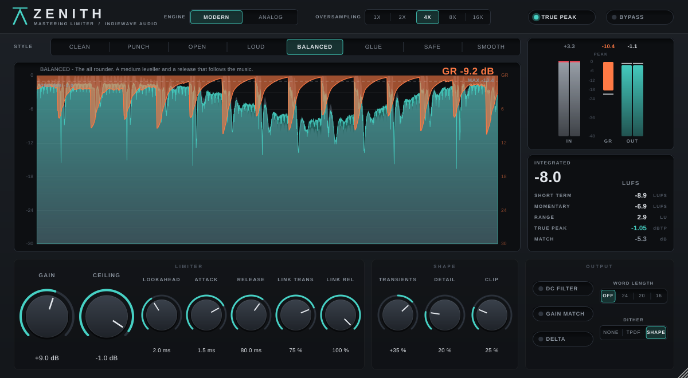

# BREAKWATER — IndieWave Audio

A mastering limiter. Two engines, eight styles, a transient and detail stage in
front, a true peak stage behind, linear phase oversampling to 16x, and the
loudness metering a master is judged by.



Built with JUCE 8. Ships as **VST3** and **Standalone** on Windows, macOS and
Linux, plus **AU** on macOS.

---

## Signal flow

```
in ─┬─────────────────────────────────────── dry (delay matched) ───────────────┐
    │                                                                           │
    └─ gain ÷ceiling ─ DC ─ transients/detail ─ leveller ─┐                     │
                                                          │                     │
         ┌──────────── oversampled 1x … 16x ──────────────┘                     │
         │                                                                      │
         └─ clip ─ Modern: lookahead peak limiter ─┐                            │
                   Analog: zero lookahead limiter ─┴─ down ─ true peak stage ─ ×ceiling ─ delta ─ match ─ dither ─ out
```

Everything between the gain and the ceiling runs in a normalised domain where
**1.0 is the ceiling**, so every stage works the same at any output level.

## Controls

### Limiter

| Control | Range | What it does |
| --- | --- | --- |
| **Gain** | −12 … +30 dB | How hard the signal is driven into the ceiling. |
| **Ceiling** | −24 … 0 dB | The level the output does not cross: sample peak, or true peak with **True Peak** on. |
| **Lookahead** | 0 … 10 ms | How far ahead the Modern engine sees. This is also its latency. |
| **Attack** | 0.01 … 10 ms | The length of the gain ramp in front of a peak, inside the lookahead. Analog engine: the charge time of its detector. |
| **Release** | 1 … 1000 ms | The base release. Every style moves it with the programme (below). |
| **Link Trans** | 0 … 100 % | Stereo link for the gain going down. |
| **Link Rel** | 0 … 100 % | Stereo link for the gain coming back. Separate, so peaks can be caught per side while the recovery stays centred. |

### Engine and style

| Engine | |
| --- | --- |
| **Modern** | A lookahead limiter that is brickwall by construction, preceded by a leveller. Eight styles. |
| **Analog** | No lookahead at all. It reacts to each sample as it arrives, the way a circuit does, so the front of a transient passes with its shape. A rectifier charges two capacitors: the fast one through a diode (program dependent attack), the slow one from the fast one (program dependent release). What gets through is caught by the true peak stage, which is short and only shaves fractions of a dB. |

| Style | Leveller | Peak stage |
| --- | --- | --- |
| **Clean** | 2:1, 3 dB above the ceiling | Full ramp, adaptive release. Transparent. |
| **Punch** | 1.6:1, slow to start | Short ramp, fast release: drum fronts arrive intact. |
| **Open** | off | Short ramp. The most dynamic. |
| **Loud** | 3:1, fast | Quick release. Density first. |
| **Balanced** | 2.5:1 | The all rounder. |
| **Glue** | 4:1, slow | Does most of the work, like a bus compressor. |
| **Safe** | off | Longest ramp, slowest release. Hardest to make distort. |
| **Smooth** | 2:1, gentle | Release rides on the programme density. |

### Shape

| Control | Range | What it does |
| --- | --- | --- |
| **Transients** | −100 … +100 % | A differential envelope transient shaper before the limiter. Positive settings push the onsets up so they still stand out after limiting; negative settings soften them. |
| **Detail** | 0 … 100 % | Lifts the quiet events between the hits (tails, ghost notes) by up to 6 dB, judged from a short against a long RMS. Never lifts anything more than 50 dB below the programme, so silence stays silent. |
| **Clip** | 0 … 100 % | An oversampled soft clipper in front of the limiter that takes the first dB off the fastest peaks, so the limiter has less to do. |

### Output

| Control | What it does |
| --- | --- |
| **True Peak** | The final stage limits on an 8x interpolated estimate of the true peak, refined with a parabola at each local maximum, with 0.05 dB kept in hand. |
| **Oversampling** | 1x, 2x, 4x, 8x, 16x for the clipper and the main limiter. Linear phase half band FIR cascade, about 110 dB of rejection, latency padded to whole samples. |
| **DC Filter** | 5 Hz high pass on the way in. |
| **Gain Match** | Monitors at the input's short term loudness, so a louder master is not mistaken for a better one. The meters still read the real output. |
| **Delta** | Plays what the limiter removes: the driven input minus the output. |
| **Word Length / Dither** | 24, 20 or 16 bit, with TPDF or noise shaped dither. Last in the chain. |

### Metering

* The main display: about seven seconds of the driven input (grey), the output
  (teal) and the gain reduction hanging from the top (orange), all on one dB
  scale, with the ceiling drawn across it.
* Input and output peak bars with hold, a gain reduction bar, and the largest
  values since the editor opened.
* BS.1770 / EBU R128 loudness: integrated, short term, momentary, loudness
  range (EBU Tech 3342), and true peak. Click the panel to reset.

## How the Modern limiter works

The peak stage works on gain reduction in dB per channel, in four steps:

1. **Requirement** — what each sample needs to sit at the ceiling, with the
   channels linked by blending each detector towards the louder one.
2. **Hold** — the largest requirement over the lookahead window, kept by a
   monotonic queue in constant time per sample.
3. **Release** — reduction is taken on at once and given back by a one pole
   whose time constant moves continuously: up to four times slower when
   limiting is sustained, up to 60 % faster for a lone spike, and never faster
   than about two bass cycles while the low end dominates, which is where fast
   release turns into distortion.
4. **Attack** — two running means in series turn the edge into an S curve.

Because every value inside the hold window is at least the peak's requirement,
and both means fit inside that window, the gain applied to a peak can never be
less than the gain it needs. The ceiling is a proof, not a tuning.

## Measured

At 48 kHz, from `breakwater_tests`:

| | |
| --- | --- |
| Sample peak over the ceiling, every engine, style and factor, +18 dB drive | under 10⁻⁶ dB |
| True peak over the ceiling, True Peak on (16x reference measurement) | 0.06 dB worst case |
| Quiet signal through the chain, 1x | bit identical |
| Quiet signal through the chain, 2x to 16x | −99 dB residual, ±0.000002 dB |
| −20 dBFS, 997 Hz stereo | −20.0 LUFS integrated |
| Oversampling latency, 1x / 2x / 4x / 8x / 16x | 0 / 83 / 91 / 94 / 95 samples |
| Total latency at the defaults (4x, 2 ms lookahead) | 284 samples, 5.9 ms |

The true peak stage and the final ramp add 25 + 72 samples at 48 kHz to every
setting; the Modern engine adds its lookahead.

## What it is, and what it is not

The feature set follows the published descriptions of three well known
mastering limiters: multiple limiting styles with separate transient and
release linking, true peak limiting and deep oversampling; transient and detail
shaping in front of the limiter with loudness matched monitoring; and a zero
lookahead, circuit style engine followed by a dedicated true peak stage.

It is **not** a copy or a measured model of any of them. No binary was
disassembled and no code or measurement of another product was used. The
algorithms are this project's own, built from published DSP methods, and the
interface is an original design; no name, logo or artwork of another product
appears in it.

## Building

Requires CMake 3.22+ and a C++20 compiler.

```bash
cd plugins/breakwater
cmake -B build -DCMAKE_BUILD_TYPE=Release          # fetches JUCE 8.0.6
cmake --build build --parallel
```

On Linux, JUCE needs the usual development headers (see the Crest README).

### Offline checks and snapshot

```bash
cmake -B build -DBREAKWATER_BUILD_TESTS=ON -DBREAKWATER_BUILD_TOOLS=ON
cmake --build build --target breakwater_tests breakwater_shot --parallel
./build/breakwater_tests_artefacts/Release/breakwater_tests
./build/breakwater_shot_artefacts/Release/breakwater_shot docs/ui.png
```

The checks assert: the peak limiter core never crosses its ceiling over
200,000 samples of bursts up to +30 dB and is a pure delay below it; the
clipper is monotonic; the true peak interpolator finds a −3 dB sampled
inter-sample peak; the ceiling holds for every engine, style, oversampling
factor and ceiling; true peak mode holds against an independent 16x
measurement, and sample peak mode alone does not; the chain is transparent
below the ceiling; reported latency matches the real latency in every
configuration; block size does not change the output; output plus delta is the
driven input; loudness reads −20 LUFS for a −20 dBFS stereo tone; Transients
and Detail move the crest factor the right way; dithered output lands on the
16 bit grid; structure changes mid stream, mono and 44.1 to 192 kHz all hold
the ceiling; and state survives a save.

## Source

```
src/dsp/PeakLimiter.h    the lookahead limiter: hold, adaptive release, S curve attack
src/dsp/AnalogLimiter.h  the zero lookahead engine
src/dsp/Leveller.h       the slow first stage of the Modern engine
src/dsp/Styles.h         the eight styles
src/dsp/Enhancer.h       Transients and Detail
src/dsp/SoftClipper.h    the clip stage
src/dsp/TruePeak.h       8x interpolator with parabolic refinement
src/dsp/Oversampler.h    linear phase half band cascade, 1x to 16x
src/dsp/Loudness.h       BS.1770 loudness and EBU 3342 range
src/dsp/Quantizer.h      word length and dither
src/dsp/Primitives.h     sliding maximum, running mean, delay
src/dsp/Meters.h         audio thread to editor
src/PluginProcessor.*    parameters, latency, the chain
src/gui/Panel.*          knobs, selectors, toggles
src/gui/Display.*        scope, meters, loudness
src/PluginEditor.*       layout, scaled as a whole from one design size
tests/Tests.cpp          the offline checks
tools/Snapshot.cpp       offscreen editor render
```

## Licence

As for the rest of this repository; see `../../LICENSE` and `../../NOTICE.md`.
