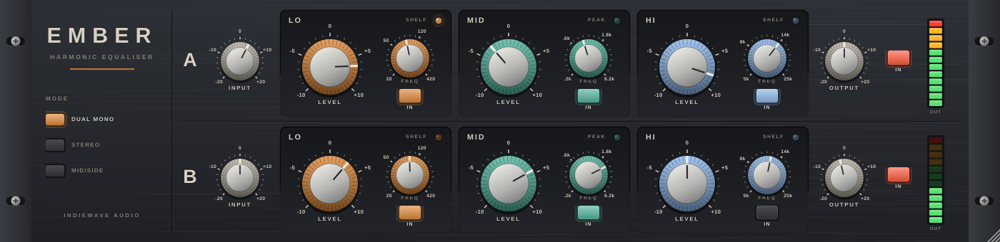

# EMBER — IndieWave Audio

A two channel harmonic equaliser. Three bands per channel, each of which boosts
or cuts by saturating the frequencies it covers rather than only changing their
level, so a band driven harder turns its boost into harmonics.



Built with JUCE 8. Ships as **VST3** and **Standalone** on Windows, macOS and
Linux, plus **AU** on macOS.

---

## Controls

Per channel strip (A and B):

| Control | Range | What it does |
| --- | --- | --- |
| **Input** | −20 … +20 dB, 1 dB steps | Level into the strip. Because every band saturates, this is also how hard the bands are driven. |
| **LO Level** | ±10 dB | Low shelf, hard clipping curve. Odd harmonics, dense. |
| **LO Freq** | 20 … 420 Hz | Shelf corner. |
| **MID Level** | ±10 dB | Peak, fixed Q of 0.9, offset tanh curve. The only band with an even series. |
| **MID Freq** | 200 Hz … 6.2 kHz | Centre. |
| **HI Level** | ±10 dB | High shelf, smooth algebraic curve. Its harmonics land above the band. |
| **HI Freq** | 5 … 25 kHz | Shelf corner. |
| **IN** (per band) | | Switches the band in or out, with a 20 ms crossfade. |
| **Output** | −20 … +20 dB, 1 dB steps | Level out of the strip. |
| **IN** (per strip) | | Switches the whole strip, trims included. Out is the input, sample for sample. |

Global:

| Control | What it does |
| --- | --- |
| **Dual Mono** | Strip A on the left channel, strip B on the right. |
| **Stereo** | Strip A on both channels. Strip B is greyed out and ignored, so the two sides cannot drift apart. |
| **Mid/Side** | Strip A on the mid, strip B on the side. The strip letters change to **M** and **S**. |

Each band has a lamp that lights as its curve starts to bend, and each strip
has a twelve segment peak meter with a clip lamp at the head (in Mid/Side mode
the meters read M and S).

## How a band works

A conventional shelf or peak adds a filtered copy of the signal back onto it:

```
out = x + k · band(x)                    k = gain − 1
```

Here the copy is saturated first:

```
out = x + k · sat(band(x) · drive) / drive
```

* Every curve has a slope of exactly 1 at zero, so a quiet band is a plain
  linear EQ and the harmonics arrive only with level.
* The drive follows the **size** of the boost or cut, not its sign. A cut
  subtracts a saturated copy, so 6 dB of cut leaves harmonics too.
* The three bands run in parallel on the same signal and are summed onto it,
  so they interact the way passive networks do.
* Everything runs at 4x: the HI band reaches 25 kHz, past Nyquist at 44.1 and
  48 kHz, and the harmonics need room above the band.

Measured at 48 kHz (from `ember_tests`):

| | |
| --- | --- |
| Quiet signal, worst deviation from the analogue prototype response | 0.17 dB |
| LO +10 dB, 60 Hz at −40 / −6 / −3 / 0 dBFS, 3rd harmonic | −137 / −48 / −23 / −18 dBc |
| MID +10 dB, 500 Hz at −6 dBFS, 2nd harmonic | −23 dBc |
| Latency | 61 samples at every rate |

## What it is, and what it is not

The control set, ranges and modes follow the published specification of a
well known hardware harmonic EQ: three bands per channel (low shelf 20–420 Hz,
fixed‑Q peak 200 Hz–6.2 kHz, high shelf 5–25 kHz, ±10 dB), hard clipping
on the low band and smooth saturation on the high band, input and output trims
of ±20 dB in 1 dB steps, per band IN switches, and dual mono, stereo and
mid/side operation.

It is **not** a measured model of that unit. No hardware was measured, so the
shapes of the curves, the drive calibration and the exact Q are this project's
own choices. The interface is an original design, and no name, logo or panel
artwork of any other product is used.

## Building

Requires CMake 3.22+ and a C++20 compiler.

```bash
cd plugins/ember
cmake -B build -DCMAKE_BUILD_TYPE=Release          # fetches JUCE 8.0.6
cmake --build build --parallel
```

On Linux, JUCE needs the usual development headers (see the Crest README).

### Offline checks and snapshot

```bash
cmake -B build -DEMBER_BUILD_TESTS=ON -DEMBER_BUILD_TOOLS=ON
cmake --build build --target ember_tests ember_shot --parallel
./build/ember_tests_artefacts/Release/ember_tests
./build/ember_shot_artefacts/Release/ember_shot docs/ui.png 1400
```

The checks assert: unity slope and monotonic curves, a null against the input
at flat settings, the quiet response matching the analogue prototype, harmonics
rising with level, cuts saturating like boosts, IN and bypass nulling exactly,
stereo, dual mono and mid/side routing, reported latency, finite output at
extreme settings across rates and block sizes, and state surviving a save.

## Source

```
src/dsp/Saturation.h    the three curves
src/dsp/HarmonicBand.h  one band: filter, curve, smoothing, drive meter
src/dsp/Meters.h        audio thread to editor
src/PluginProcessor.*   parameters, routing, oversampling, the strips
src/gui/Panel.*         knobs, lamps, mode buttons, meters, all drawn in code
src/PluginEditor.*      layout, scaled as a whole from one design size
tests/Tests.cpp         the offline checks
tools/Snapshot.cpp      offscreen editor render
```

## Licence

As for the rest of this repository; see `../../LICENSE` and `../../NOTICE.md`.
