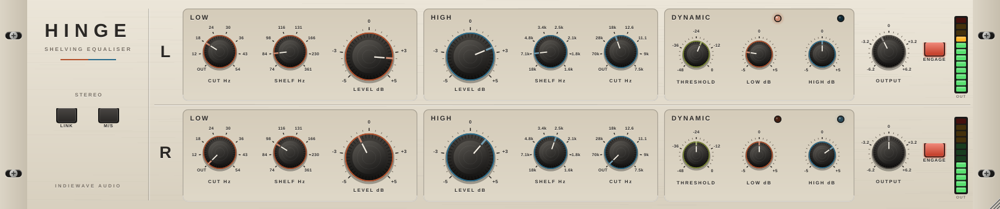

# HINGE — IndieWave Audio

A two channel Baxandall shelving equaliser. Broad low and high shelves on
stepped attenuators, a switched low cut and high cut, and an output trim, per
channel, with link and mid/side. Plus one thing the hardware cannot do: shelves
that move with the music.



Built with JUCE 8. Ships as **VST3** and **Standalone** on Windows, macOS and
Linux, plus **AU** on macOS. Zero latency.

---

## Controls

Per channel row (L and R, or M and S):

| Control | Positions | What it does |
| --- | --- | --- |
| **LOW CUT** | Out, 12, 18, 24, 30, 36, 43, 54 Hz | Second order Butterworth high pass, 12 dB/octave. Out is out: the filter is not in the path. |
| **LOW SHELF** | 74, 84, 98, 116, 131, 166, 230, 361 Hz | Where the low shelf sits. The legend is the **bottom shoulder** of the slope; the curve reaches well up into the midrange from there. |
| **LOW LEVEL** | −5 … +5 dB, 21 detents | Half a dB per detent, measured at the shelf's legend. |
| **HIGH LEVEL** | −5 … +5 dB, 21 detents | As above, for the high shelf. |
| **HIGH SHELF** | 18, 7.1, 4.8, 3.4, 2.5, 2.1, 1.8, 1.6 kHz | The legend is the **middle** of the slope; full boost arrives about an octave above it. Clockwise moves it down, so clockwise always means more. |
| **HIGH CUT** | Out, 70, 28, 18, 12.6, 11.1, 9, 7.5 kHz | Second order low pass, a hair under Butterworth. |
| **THRESHOLD** | −48 … 0 dB | Where the dynamic shelves start to move. |
| **LOW DYN** / **HIGH DYN** | −5 … +5 dB | How far each shelf moves when its band is loud. See below. |
| **OUTPUT** | 21 steps, ±6.2 dB | A gain pot, so the steps are a little over half a dB and not quite equal. |
| **ENGAGE** | | Out is the input, sample for sample, with a 20 ms crossfade on the switch. |

Global:

| Control | What it does |
| --- | --- |
| **LINK** | Row L drives both channels; row R is greyed out and ignored. The dynamics listen to both channels with one ear, so they cannot pull the image sideways. |
| **M/S** | Row L works on the mid, row R on the side. The row letters change to **M** and **S**. Each listens to its own signal. |

Each row has a twelve segment peak meter, and each dynamic shelf a lamp that
lights as it moves.

## How the shelves work

Each shelf is a Baxandall network: a stepped attenuator whose two halves either
side of the wiper set the curve, and a switched capacitor that sets where the
curve sits. The plugin computes the network's transfer function directly from
its resistor and capacitor values, at every setting, rather than approximating
the curves with textbook filters.

Two properties fall out of that and are asserted by the checks:

* **Cut is boost upside down.** The shelf is one half of the network over the
  same half with the attenuator mirrored. Swap the halves and the curve
  inverts exactly, at every frequency.
* **The centre detent is flat to the last bit**, not nearly flat: at the centre
  the two halves are identical. A flat panel nulls against its input at
  −290 dB.

The curves themselves are what the hardware documentation describes. Measured
on the network:

| | |
| --- | --- |
| Low shelf, every detent against its nominal half dB step, at the legend | within 0.10 dB |
| Low shelf at full boost, at the legend | +5.0 dB |
| High shelf at full boost, at the legend | about +3.1 dB, mid slope |
| High shelf at full boost, an octave above the legend | about +4.8 dB |

### At a sample rate

A shelf named at 18 kHz has to stay an 18 kHz shelf at 44.1 kHz, where the
bilinear transform would squash it against Nyquist. Hinge does not oversample.
Each section is designed from the analogue network by mapping its poles exactly
(z = e^sT) and fitting its zeros to the analogue magnitude across the audio band
by least squares, with DC pinned exactly. The fit is a linear problem, so it
runs every few samples without trouble.

From `hinge_tests`, the worst deviation from the analogue network anywhere
from 20 Hz to 20 kHz (19.8 kHz at 44.1 kHz), over all switch positions and many
wiper settings:

| Rate | Shelves | Cuts |
| --- | --- | --- |
| 44.1 kHz | 0.18 dB | 0.23 dB |
| 48 kHz | 0.11 dB | 0.11 dB |
| 96 kHz | 0.003 dB | 0.003 dB |

Measured through the plugin with sine tones, 40 Hz to 15 kHz,
three panel settings: within 0.08 dB at 48 kHz.

The filters are direct form I in double precision. Every control is smoothed,
and coefficients are redesigned only while something is moving, so a switch
thrown under signal glides rather than clicks (the checks throw every switch at
random under a tone and assert no sample to sample step larger than the tone
itself can make through the gain on the panel).

## Dynamic shelves

The hardware's shelves are where you leave them. Here each one can also move
with its own band:

```
shelf = LEVEL + DYN × clamp ((band level − THRESHOLD) / 12 dB, 0, 1)
```

* The low side chain listens below twice the low shelf's shoulder; the high one
  listens above the middle of the high shelf's slope. Each follows the shelf
  switch.
* **Negative DYN tames.** +4 dB of low shelf with DYN at −4 is a fat bottom on a
  quiet passage and flat on a loud kick. +3 dB of air with DYN at −3 stops the
  cymbals getting harsh when they arrive.
* **Positive DYN lifts.** The shelf opens up as the band gets louder.
* The movement is a wiper sliding along the attenuator between detents, so a
  shelf in motion is still the same network: same shape, same mirror symmetry.
  It cannot pass the attenuator's ends, ±5 dB.
* The full DYN amount arrives 12 dB above the threshold. The envelope is 8 ms
  attack, 160 ms release, so it rides phrases rather than the waveform.
* At DYN 0 the side chain is ignored entirely: the output is bit identical to
  the static EQ, whatever the threshold says.

Measured: a loud 50 Hz tone through +5 dB of low shelf with DYN −5 comes out at
0.0 dB; the same tone about 45 dB quieter keeps its +5. A loud 6 kHz tone does not
move the low shelf at all.

## What it is, and what it is not

The control set, switch positions and ranges follow a well known two channel
Baxandall shelving equaliser: low cut, low shelf, two stepped level controls,
high shelf and high cut per channel, link and mid/side.

It is not that product, nor affiliated with its makers. No hardware was
measured. The dynamic shelves are this project's own. The interface is an
original design, and no name, logo, artwork or code of any other product is
used.

## Building

Requires CMake 3.22+ and a C++20 compiler.

```bash
cd plugins/hinge
cmake -B build -DCMAKE_BUILD_TYPE=Release          # fetches JUCE 8.0.6
cmake --build build --parallel
```

On Linux, JUCE needs the usual development headers (see the Crest README).

### Offline checks and snapshot

```bash
cmake -B build -DHINGE_BUILD_TESTS=ON -DHINGE_BUILD_TOOLS=ON
cmake --build build --target hinge_tests hinge_shot --parallel
./build/hinge_tests_artefacts/Release/hinge_tests
./build/hinge_shot_artefacts/Release/hinge_shot docs/ui.png 1620
```

The checks assert: the network's documented behaviour (half dB detents, shoulder
and mid slope legends, mirror symmetry, a flat centre, cut frequencies, output
range), the digital filters against the network at 44.1 to 192 kHz, measured
responses through the plugin, nulls for a flat panel, ENGAGE and bypass, zero
latency, link and mid/side routing, the dynamic shelves taming, lifting,
ignoring the other band and linking, click free switching under signal, finite
output at extreme settings across rates and block sizes, and state surviving a
save.

## Source

```
src/dsp/Network.h        the circuit: attenuator, shelf networks, switch tables
src/dsp/MatchedDesign.h  analogue to digital: exact poles, fitted zeros; the biquad
src/dsp/ChannelEq.h      one channel: smoothing, dynamics, the signal path
src/dsp/Meters.h         audio thread to editor
src/PluginProcessor.*    parameters, link, mid/side, control rate
src/gui/Panel.*          knobs, lamps, meters, all drawn in code
src/PluginEditor.*       layout, scaled as a whole from one design size
tests/Tests.cpp          the offline checks
tools/Snapshot.cpp       offscreen editor render
```

## Licence

As for the rest of this repository; see `../../LICENSE` and `../../NOTICE.md`.
