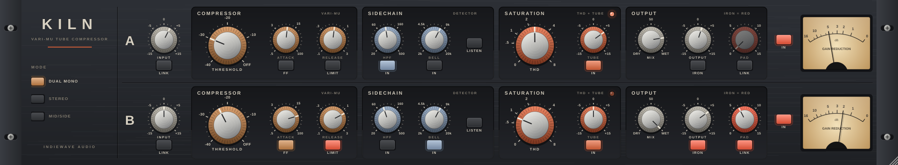

# KILN — IndieWave Audio

A two channel variable-mu tube compressor, modelled on a well known hardware
unit with digital recall. No ratio knob: like the hardware, the ratio is a property of level,
gentle at the threshold and steepening as the signal goes past it. Around the
vari-mu tube sit input transformers, a calibrated THD stage, a TUBE drive
control, and a choice of output: RED (tube amplifier, transformer and IRON PAD)
or GREEN (clean).



Built with JUCE 8. Ships as **VST3** and **Standalone** on Windows, macOS and
Linux, plus **AU** on macOS.

---

## Signal flow

Following the block descriptions in the hardware's user manual:

```
in ─┬─ [M/S encode] ─ input ─ input iron ─┬─ THD ─ vari-mu tube ──┬─ mix ─ output ─ [M/S decode] ─┬─ GREEN ───────────────┬─ out
    │                                     │          ▲    (TUBE)  │   ▲                            └─ RED: tube ─ iron ─ PAD┘
    │                                     │   law ◄ envelope ◄ rectifier ◄ SC HPF / high bell     │   │
    │                                     │          FF: from the cell's input ┘  ▲                │   │
    │                                     │          FB: from the cell's output ──┘                │   │
    │                                     └───────────────────── dry ─────────────────────────────┴───┘
    └─ IN / bypass: true bypass per physical channel, delay matched, so switching out is the input exactly
```

Everything from the input trim to the output stage runs at 4x.

## Controls

Per channel strip (A and B):

| Control | Range | What it does |
| --- | --- | --- |
| **Input** | ±15 dB, 0.25 dB steps | Level into the unit: the input transformer, THD, tube and compressor all see it. |
| **LINK** | | Dynamic link: turning Input or Threshold moves the other the same way and Output the opposite way, so the drive changes and the level does not. |
| **Threshold** | −40 … 0 dB, **0 = off** | Below the +26 dBu ceiling. Fully clockwise the compressor does nothing, as on the unit. |
| **Attack** | 0.5 … 100 ms | Rectifier timing capacitor, charge. |
| **Release** | 0.1 … 3 s | Rectifier timing capacitor, discharge. |
| **FF** | | Off: feedbackward, the detector listens to the tube's output (the classic vari-mu, and the unit's default). On: feed-forward, it listens to its input, through a curve that makes vari-mu behave there (no negative compression). |
| **LIMIT** | | A steeper law, in either mode: about 3:1 at the threshold, past 8:1 well over it. |
| **HPF** + **IN** | 20 … 500 Hz | Sidechain high pass, 6 dB/oct, switchable. |
| **BELL** + **IN** | 2 … 20 kHz | Sidechain high bell boost, +6 dB, switchable. |
| **LISTEN** | | Plays the sidechain signal, filters included. |
| **THD** | 0 … 8 % | First saturation stage, ahead of the compressor. Calibrated (see below); 0 is out of circuit. |
| **TUBE** + **IN** | ±15 dB | Drive into the vari-mu tube. Made up again after it, and the detector is compensated, so the compression does not change. The tube is always in the path; IN takes its saturation out. |
| **Mix** | 0 … 100 % | Parallel compression, sample aligned. The dry half is taken after the input transformer. |
| **Output** | ±15 dB, 0.25 dB steps | After the mix. In RED mode it is also what drives the tube and the iron. |
| **IRON** | | RED: tube amplifier, output transformer and PAD. Off: GREEN, electronically balanced, clean. |
| **PAD** | 0 … 15 dB, 1 dB steps | IRON PAD: a passive attenuator at the very end, RED only, after the mix. |
| **LINK** (output) | | Iron link: Output and PAD move together, so the iron is driven harder at the same level. |
| **IN** | | True bypass of the channel. |

Global **Mode**: **Dual Mono** (independent strips and detectors), **Stereo**
(strip A on both channels with one shared detector; B greys out) and
**Mid/Side** (A on the mid, B on the side, detectors unlinked). In Stereo and
Mid/Side the output transformers stay in left/right, outside the M/S matrix,
and both follow strip A; strip B's output stage greys out.

Each strip has a moving coil gain reduction meter, 0 to 16 dB like the unit's,
and a heater lamp in the SATURATION section that glows as THD is driven.

## How it is modelled

**The gain law.** A vari-mu has no ratio control: a remote cutoff tube's gain
falls faster the further its grid is pushed negative. With *e* the rectified
level's excess over the threshold, as a fraction of it,

```
GR (dB) = K · (e + c · e²)
```

which in the feedback loop gives the soft knee and rising ratio the manual
describes. Measured (1 kHz, threshold −30 dBFS, from `kiln_tests`):

| Input over threshold | 3 dB | 9 dB | 15 dB | 24 dB | 30 dB |
| --- | --- | --- | --- | --- | --- |
| Gain reduction | 0.9 dB | 3.9 dB | 7.8 dB | 14.6 dB | 19.5 dB |
| Local ratio | 1.4:1 | 2.2:1 | 3.1:1 | 4.7:1 | 5.8:1 |

Feed-forward solves the same law the other way round. A plain feed-forward
vari-mu over-compresses, which the manual says the maker fixed with a
logarithmic curve; here the inverse table plays that part, so FF and FB agree
on the static curve to a fraction of a dB and the output never falls as the
input rises. LIMIT reaches about 10:1 at 12 to 24 dB over.

**The rectifier** is full wave with a timing capacitor, not an RMS detector, so
a fast attack on a low note ripples the gain, as it does on the hardware.

**The tube** is push-pull, so mostly odd harmonics. It is always in the path:
at rest it measures **0.006 % at 1 kHz, 0 dBu** (the manual specifies THD+N
below 0.01 %). TUBE +15 dB takes it from 0.012 % to 1.8 % at +4 dBu without
moving the compression (checked to 0.5 dB). Its curvature also grows with the
reduction: 0.003 % at light reduction, 0.34 % at heavy (TUBE saturation off).

**THD** is a biased triode curve, calibrated: the knob reads the distortion it
produces on a 1 kHz sine at the +4 dBu operating level (−14 dBFS; 0 dBu =
−18 dBFS and the +26 dBu ceiling = +8 dBFS throughout). 0.5 / 1 / 4 / 8 %
measure 0.50 / 1.00 / 4.00 / 8.00 %.

**The transformers** saturate on flux, the integral of the voltage, so a loud
bass note pushes the core far harder than the same level at 1 kHz. RED at
−2 dBFS: 1.1 % at 30 Hz against 0.4 % at 1 kHz (the latter is the tube line
amp), and 5.4 % at 30 Hz with Output +10 and PAD 10 at about the same level.
The input transformers are always in circuit and set the low end: −1.6 dB at
12 Hz (the manual gives −3 dB at 12 Hz for the whole unit).

Latency: 61 samples at every rate, reported to the host.

## What it is, and what it is not

Kiln is modelled on a well known hardware vari-mu compressor as its user
manual describes it: every control, range, switch and mode above, the order of
the blocks, where the dry path and the IRON PAD sit, the transformers working
in left/right in M/S mode, the linking features, and the specified THD+N,
frequency response, attack and release ranges.

It is **not** a measured model of that unit. No hardware was measured, so the
following are this project's own choices, made to fit the manual's
descriptions and specifications:

* the shape and constants of the gain law, in both modes and in LIMIT;
* the level reference (0 dBu = −18 dBFS);
* the sidechain HPF slope (6 dB/oct, as on the same maker's bus compressor) and the
  bell's gain and width, which the manual does not give;
* the curves of the THD stage, the tube and the transformers;
* the dry tap for the mix (after the input transformer, before THD).

Features of the unit left out: the separate output values the unit keeps for
RED and GREEN, IRON PAD mix compensation, mute, and the A/B/C memories (a DAW
does that job). The interface is an original design in the IndieWave style,
and no name, logo or panel artwork of any other product is used.

If you own the unit, the constants to adjust against it are at the top of
`src/dsp/VariMu.h` (law, tube, sidechain), `src/dsp/Tube.h` (THD reference
level) and `src/dsp/OutputStage.h` (transformers, tube line amp, pad).

## Building

Requires CMake 3.22+ and a C++20 compiler.

```bash
cd plugins/kiln
cmake -B build -DCMAKE_BUILD_TYPE=Release          # fetches JUCE 8.0.6
cmake --build build --parallel
```

On Linux, JUCE needs the usual development headers (see the Crest README).

### Offline checks and snapshot

```bash
cmake -B build -DKILN_BUILD_TESTS=ON -DKILN_BUILD_TOOLS=ON
cmake --build build --target kiln_tests kiln_shot --parallel
./build/kiln_tests_artefacts/Release/kiln_tests
./build/kiln_shot_artefacts/Release/kiln_shot docs/ui.png 1840
```

The checks assert: the THD table inverts; the idle response is flat and the
resting tube stays under the specified 0.01 % at 0 dBu; the ratio rises with
level and the output never falls as the input rises; FF and FB share one
static curve; LIMIT is harder; attack and release times scale; the THD knob
reads true; TUBE saturates without changing the compression; the iron
saturates on bass, Output up with PAD down drives it harder at the same level,
and the PAD is a plain attenuator in RED only; the sidechain filters, their
switches and listen work; IN, bypass and mix at 0 % behave; stereo linking
holds the image; the mid/side matrix reconstructs and the iron stays in
left/right; reported latency; finite output at extreme settings across rates
and block sizes; and state surviving a save.

## Source

```
src/dsp/VariMu.h        gain law, rectifier, the vari-mu tube, sidechain filter
src/dsp/Tube.h          triode curve, THD calibration, level reference
src/dsp/OutputStage.h   transformers, tube line amp, RED/GREEN, iron pad
src/dsp/Meters.h        audio thread to editor
src/PluginProcessor.*   parameters, routing, linking, oversampling, the strips
src/gui/Panel.*         knobs, lamps, mode buttons, VU meter, all drawn in code
src/PluginEditor.*      layout, dynamic and iron links, scaled as a whole from one design size
tests/Tests.cpp         the offline checks
tools/Snapshot.cpp      offscreen editor render
```

## Licence

As for the rest of this repository; see `../../LICENSE` and `../../NOTICE.md`.
