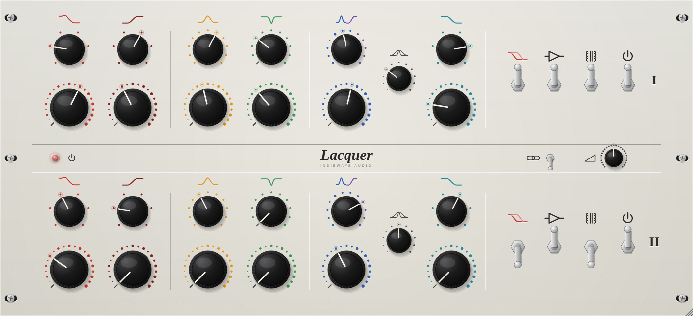

# LACQUER — IndieWave Audio

A dual channel, six band, stepped inductor equaliser for mix bus and mastering,
modelled on the published design of the **Terry Audio CEQ**: passive resonant
bass shelves, a broad passive mid boost, an active mid cut whose Q narrows as it
cuts, a treble boost that is either an inductor bell or an RC shelf, a passive
treble cut, and the switchable input buffer, output transformer and **Shift**
filter set around them.



Built with JUCE 8. Ships as **VST3** and **Standalone** on Windows, macOS and
Linux, plus **AU** on macOS.

---

## Controls

Per channel (I and II), left to right. Like the hardware, the panel carries no
numbers: each band is marked by a symbol of its curve and a colour, and each
switch by a ring of dots, one per position. Hover or drag a knob to see the
value.

| Band | Frequency positions | Amount |
| --- | --- | --- |
| **Bass boost** (red), resonant shelf | 47, 70, 100, 160, 200, 340 Hz | 0–10 in half steps, up to +13 dB |
| **Bass cut** (dark red), shelf | 27, 50, 80, 140, 220, 480 Hz | 0–10, up to −16 dB |
| **Mid boost** (amber), broad bell | 310, 470, 680, 820 Hz, 1, 1.8, 2.5, 3, 4, 6.3, 8.2 kHz | 0–10, up to +10 dB |
| **Mid cut** (green), active bell, dynamic Q | OUT, 260, 470, 820 Hz, 1, 1.3, 2.1, 3, 4.5, 6.3, 9.3 kHz | 0–10, up to −14 dB |
| **Treble boost** (blue bell / violet shelf) | bells: 2.5, 4.2, 8, 10 (low L), 10 (high L), 13.9, 18 kHz · shelves: 18, 15, 10, 6, 1 kHz | 0–10, up to +15 dB |
| **Treble Q** (grey) | 0–10: bell width wide → narrow, or shelf knee soft → hard | |
| **Treble cut** (teal), shelf | 4, 6, 10, 12, 18, 24 kHz | 0–10, up to −16 dB |

Four toggles per channel, each under its symbol (up is on):

| Symbol | Switch | What it does |
| --- | --- | --- |
| two shelves | **Shift** | Swaps in the second filter set of the bass section: corners move, both shelves tighten, the boost grows a resonant shoulder. Off is the softer, classic voice. |
| amplifier | **Buffer** | The balanced input buffer. On adds a faint second harmonic; off feeds the network directly. |
| coils | **Transformer** | The 1:1 output transformer. On, the core thickens and compresses the lows at level, and the top octave softens by a fraction of a dB. Off is the single ended output. |
| power | **EQ In** | Relays the filter network in and out. The amplifiers stay in circuit. |

In the bar between the channels: the pilot lamp (lit unless bypassed),
**Link** (channel I's controls drive both channels; channel II greys out) and
an **Output** trim of ±12 dB, which the hardware does not have.

## Signal flow

```
in ─ buffer / direct ─ bass boost ─ bass cut ─ mid boost ─ mid cut ─ treble bell ─ treble shelf ─ treble cut ─ make up amp ─ transformer / direct ─ trim ─ out
     (switch)          └──────────────────── EQ IN relays this out ───────────────────────────────┘                             (switch)
```

Everything between the input and the trim runs at 4x. The 24 kHz treble cut and
18 kHz bell sit close to Nyquist at 44.1 and 48 kHz, and the bilinear transform
would cramp them there; at 4x every section lands within 0.05 dB of its
analogue prototype across the audio band.

Each section is a second order analogue prototype, realised as a trapezoidal
state variable filter, so a stepped switch glides between positions over 20 ms
instead of clicking. A section at 0 dB is the input, sample for sample. The
treble boost is two sections, a bell and a shelf, of which only the selected one
has gain: turning the switch from the last bell to the first shelf fades one
shape into the other.

## What it is, and what it is not

**From published sources:** the six band layout; every frequency position of
every band; which bands are passive and which active; that the bass section
follows the Pultec family of resonant shelves and the mid boost the Neumann PEV;
that the mid cut's Q is "dynamic", narrowing as it cuts; that the treble boost
is an inductor bell or, without the inductor, a shelf, with a Q control for
either; the two 10 kHz bells on different inductors; that Shift switches a
second capacitor set into the bass filters; the switchable input buffer and
custom 1:1 output transformer; the stepped controls, which reviewers say do
little until most of the way round; the white panel with colour coded,
unnumbered markings and symbols over the toggles.

**This project's estimates**, because no hardware was measured and the gain
ranges and curve shapes are not published: the maximum gain of each band, the
square law taper of the amount switches, every Q, what exactly Shift does to the
bass corners and Qs, and the level and spectrum of the harmonics. They are all
in `src/dsp/Voicing.h` and `src/dsp/Colour.h`, one constant each, so the
voicing can be retuned against a real unit.

Calibration: 0 dBFS is +18 dBu. Measured at 48 kHz (from `lacquer_tests`):

| | |
| --- | --- |
| All amounts at zero, buffer in, transformer out, 30 Hz – 18 kHz | within 0.003 dB |
| Same, unbuffered through the transformer | −0.12 dB at 30 Hz, −0.04 dB at 18 kHz |
| Transformer, 30 Hz at 0 / −30 dBFS, 3rd harmonic | −39 / −99 dBc |
| Transformer, 1 kHz at 0 dBFS, 3rd harmonic | −70 dBc |
| Amplifiers, 1 kHz at 0 dBFS, 2nd harmonic, buffer in / out | −46 / −55 dBc |
| Latency | 61 samples at every rate |

The name, logo and panel artwork are this project's own; no Terry Audio name,
logo or artwork is used on the plugin. Terry Audio and CEQ are trademarks of
their owner, named here only to say what the design follows.

## Building

Requires CMake 3.22+ and a C++20 compiler.

```bash
cd plugins/lacquer
cmake -B build -DCMAKE_BUILD_TYPE=Release          # fetches JUCE 8.0.6
cmake --build build --parallel
```

On Linux, JUCE needs the usual development headers (see the Crest README).

### Offline checks and snapshot

```bash
cmake -B build -DLACQUER_BUILD_TESTS=ON -DLACQUER_BUILD_TOOLS=ON
cmake --build build --target lacquer_tests lacquer_shot --parallel
./build/lacquer_tests_artefacts/Release/lacquer_tests
./build/lacquer_shot_artefacts/Release/lacquer_shot docs/ui.png 1400
```

The checks assert: every switch has the published positions; the taper rises at
every step; OUT and idle sections are flat; each filter section matches its
analogue prototype and is transparent at 0 dB; each band reaches its full gain
through the processor and disappears with EQ IN off; the bell and shelf halves
of the treble boost; the transformer's low frequency harmonics, their level
dependence and their absence in the mids; the buffer's effect on the second
harmonic; link, channel independence and an exact bypass; latency the same at
every rate and lined up with the output; finite output at extreme settings and
under random automation; and state surviving a save.

## Source

```
src/dsp/Band.h          one filter section and its analogue prototype
src/dsp/Voicing.h       switch positions, and what each one does to the network
src/dsp/Colour.h        input buffer, make up amplifier, output transformer
src/PluginProcessor.*   parameters, link, oversampling, the channel paths
src/gui/Panel.*         knobs, dot scales, symbols, toggles, pilot lamp, all drawn in code
src/PluginEditor.*      layout, scaled as a whole from one design size
tests/Tests.cpp         the offline checks
tools/Snapshot.cpp      offscreen editor render
```

## Sources

* Terry Audio, CEQ product page and *CEQ Dual Passive 6 Band Inductor Equalizer* factsheet
* Sound On Sound, *Terry Audio CEQ* review
* Tape Op #141, *CEQ 6-Band EQ* review
* MusicTech, *Terry Audio CEQ is a super EQ*
* Dealer listings (Vintage King, KMR Audio) and the Gearspace AES 2019 thread

Where the factsheet and the current product page disagree (the top mid boost
position, 12 kHz against 8.2 kHz; the treble shelf, 5 kHz against 6 kHz), the
product page is followed.

## Licence

As for the rest of this repository; see `../../LICENSE` and `../../NOTICE.md`.
