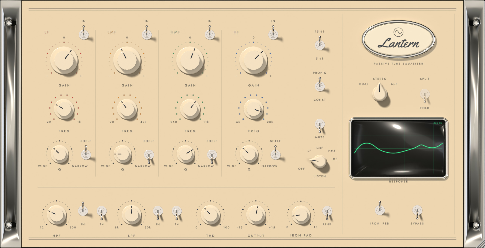

# LANTERN — IndieWave Audio

A stereo four band passive tube equaliser, modelled on a well known two
channel hardware unit with digital recall from the same maker as the
vari-mu Beacon follows, after that unit's user manual, and dressed to sit
beside Beacon in a rack. Four inductor bands of twelve positions each, every
one with a Q knob and a bell or shelf, proportional or constant Q, a 5 or
15 dB gain mode, a band focus listen mode, active high and low pass filters,
a THD stage that drives the passive section, and a choice of output: RED
(tube amplifier, transformer and IRON PAD) or GREEN (clean), each with its
own level. The centre of the panel draws the response.



Built with JUCE 8. Ships as **VST3** and **Standalone** on Windows, macOS and
Linux, plus **AU** on macOS.

---

## Signal flow

Following the manual: THD is the first block, the passive section follows,
and the active filters come after it.

```
in ─┬─ [M/S encode] ─ THD ─ LF ─ LMF ─ HMF ─ HF ─ HPF ─ LPF ─ output ─ mute ─ [M/S decode] ─┬─ GREEN ───────────────┬─ out
    │                       (passive inductor bands)  (active)                              └─ RED: tube ─ iron ─ PAD┘
    └─ bypass: delay matched, so switching out is the input exactly
```

Everything after the bypass split runs at 4x.

## Controls

Each band, as on the unit: **GAIN** on top (push **ON** to switch the band in
or out), **FREQ**, then **Q** with its **SHELF** key.

| Band | Positions (from the front panel) | Shelf |
| --- | --- | --- |
| **LF** | 22, 33, 60, 100, 150, 220, 300, 410, 500, 730, 860 Hz, 1 kHz | low |
| **LMF** | 90, 120, 180, 290, 430, 620 Hz, 1, 1.2, 1.9, 2.7, 3.9, 4.8 kHz | low |
| **HMF** | 260, 380, 550, 970 Hz, 1.2, 1.7, 2.8, 3.8, 5.5, 7.8, 9, 11 kHz | high |
| **HF** | 600, 800 Hz, 1.2, 1.8, 2.8, 4.1, 6, 8.2, 10, 13, 18, 28 kHz | high |

| Control | Range | What it does |
| --- | --- | --- |
| **GAIN** | ±15 dB in 0.25 dB steps, or ±5 dB in 0.083 dB steps | The 15/5 key picks the gain mode; the same knob position is worth a third in 5 dB mode. Hosts show the 15 dB reading. |
| **Q** | 0.5 … 4.0 | A bell's width. On a shelf it shapes the corner, from a gentle slope to one with a small bump either side. |
| **SHELF** | | The band shelves instead of being a bell. |
| **PROP. Q** | | Lit: proportional Q, the bells narrow as they are pushed (broad for small moves, the knob's Q at 10 dB). Out: constant Q. Shelves are not affected. Per channel, as on the unit. |
| **LISTEN** | per band | Band focus: the high and low pass close in around the band, at 24 dB/oct, as wide as its Q, so only that region is heard. |
| **HPF** + **ON** + **24** | 12 … 300 Hz | Active high pass after the passive section, 12 dB/oct or 24 with the key. Butterworth. |
| **LPF** + **ON** + **24** | 8 … 50 kHz | Active low pass, the same. |
| **THD** | 0 … 100 % | The first block: saturation that then drives the passive bands. 0 takes it out. A square law to 8 % at +4 dBu: 25 % is 0.5 %, 50 % is 2 %. |
| **OUTPUT** | ±15 dB, 0.25 dB steps | One knob with two values, as on the unit: green LEDs for GREEN, red for RED, where it drives the tube and the iron. |
| **MUTE** | | Silences the channel; in mid/side, the mid or the side. |
| **IRON** | | RED: tube line amp, output transformer and PAD (IRON PAD with its LINK to the RED output, on the first panel). Off: GREEN. |
| **BYPASS** | | The host's bypass, on the panel. |

**Mode**, as on Beacon: **Stereo** is one set of settings for both channels;
**Dual Mono** with the tab pulled (**SPLIT L/R**) folds out a right panel
with its own; **Mid/Side** equalises mid and side separately. The curve
shows the first panel in green and the second in amber. The output
transformers work in left/right, outside the M/S matrix.

### Measured (from `lantern_tests`, 48 kHz)

| | |
| --- | --- |
| All bands at 0, filters out, 30 Hz – 15 kHz | within 0.02 dB |
| THD+N at +4 dBu, GREEN | 0.0004 % (specified: 0.0025 %) |
| THD at +4 dBu, RED | 0.041 % (specified: 0.04 %) |
| Sections against their analogue prototypes | within 0.06 dB to 10 kHz, 0.35 dB to 20 kHz |
| Bell width at half its boost, Q 1, proportional, 3 / 12 dB | 2.3 / 1.3 octaves |
| Same, constant Q / Q 0.5 / Q 4 at 12 dB | 1.4 / 2.6 / 0.37 octaves |
| LISTEN on 1.2 kHz, at 150 Hz and 10 kHz | −56 / −57 dB |
| 3rd harmonic of 1 kHz at THD 100, then a 15 dB HF cut | −51 → −65 dB |
| Latency | 61 samples at every rate |

## What it is, and what it is not

**From the hardware's user manual:** four passive inductor bands of twelve
positions each (the values printed on the front panel), every band bell or
shelf, the low two shelving low and the high two high; a Q knob of 0.5 to 4
for the bells, which also shapes the shelves; proportional or constant Q,
which does not touch the shelves; the 15 dB and 5 dB gain modes and their
steps; per band ON; per channel PROP. Q, gain mode and mute; band focus
listen; active high and low pass filters of 12 or 24 dB/oct after the
passive section, the high pass from 12 to 300 Hz and the low pass from 8 to
50 kHz; THD of 0 to 100 % as the first block, bypassed at 0, driving the
passive section; output of ±15 dB in 0.25 dB steps with a value for each
output stage; the RED output with tube, transformer and IRON PAD of 0 to
15 dB with its link, and the clean GREEN output; stereo, dual mono and
mid/side, with the output transformers outside the M/S matrix; and the
THD+N figures quoted above.

**This project's own choices,** because no hardware was measured and the
manual does not give them: how proportional Q depends on gain; how the Q
knob maps onto a shelf; how wide the listen window is for a given Q; the
law between the THD knob and the distortion; continuous rather than
stepped filter frequencies (the unit has about 80 steps); and that the
inductors themselves stay linear, where on the unit THD driving them adds a
little saturation of their own. All are constants at the top of
`src/dsp/Eq.h`, `src/PluginProcessor.h` and `src/dsp/OutputStage.h`.

Left out: the unit's parameter link and solo (the split panel does the
former's job), and its A/B/C memories and presets (a DAW does that). The
interface is an original design in the IndieWave style; no name, logo or
panel artwork of any other product is used.

## Building

Requires CMake 3.22+ and a C++20 compiler.

```bash
cd plugins/lantern
cmake -B build -DCMAKE_BUILD_TYPE=Release          # fetches JUCE 8.0.6
cmake --build build --parallel
```

On Linux, JUCE needs the usual development headers (see the Crest README).

### Offline checks and snapshot

```bash
cmake -B build -DLANTERN_BUILD_TESTS=ON -DLANTERN_BUILD_TOOLS=ON
cmake --build build --target lantern_tests lantern_shot --parallel
./build/lantern_tests_artefacts/Release/lantern_tests
./build/lantern_shot_artefacts/Release/lantern_shot docs/ui.png 1.0 stereo   # or dual, ms
```

The checks assert: every band rises at every step and spans its published
range, with the manual's curve points among its positions; every section
matches its analogue prototype and a section at 0 dB is a wire; a flat,
clean idle; bands switched out are flat; the bells reach their gain at their
centre; every band shelves the right way and SHELF out makes a bell; the Q
knob shapes a shelf's corner and a bell's width; the 5 dB mode divides by
three; proportional Q narrows with gain, constant Q does not, and the mode
reaches the audio; listen isolates a band and narrows with its Q; both
filters at their corner and slope, and inert when off; the THD calibration
and the equaliser working on what THD made; the tube output's distortion;
the iron driven harder at the same level; each output stage's own level;
mute; bypass; mid/side, the side's own settings, the iron in left/right;
dual mono split; latency; finite output at extreme settings and under random
automation; a frequency switch gliding without a click; state; and that
sessions saved by released versions (`tests/compat/`) open unchanged.

## Source

```
src/dsp/Eq.h            band positions, Q laws, the filter sections and their prototypes
src/dsp/Tube.h          triode curve, THD calibration, level reference (as Beacon)
src/dsp/OutputStage.h   transformer, tube line amp, RED/GREEN, iron pad (as Beacon)
src/dsp/Meters.h        audio thread to editor
src/PluginProcessor.*   parameters, gain mode, Q mode and listen, channel modes, oversampling
src/PluginEditor.*      the panel, the response curve, output per stage, iron link, folding
tests/Tests.cpp         the offline checks
tools/Snapshot.cpp      offscreen editor render
```

## Licence

As for the rest of this repository; see `../../LICENSE` and `../../NOTICE.md`.

## Re-rendering the panel

The panel is rendered in Blender from `art/spec.py` with the range's kit, see
`shared/indiewave/art/README.md`.
