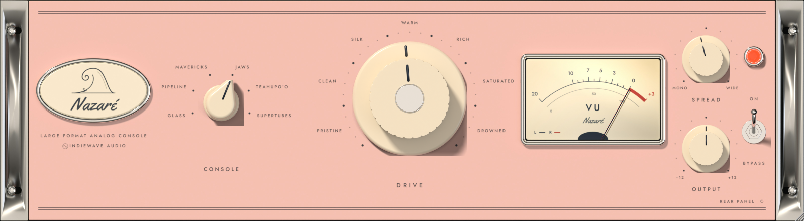
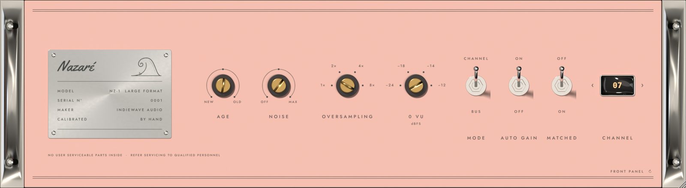

# NAZARÉ — IndieWave Audio

A large format analog console channel. Six consoles, one drive knob that goes
from untouched to drowned, and a stereo image made from two channels that are
not quite the same.




Built with JUCE 8. Ships as **VST3** and **Standalone** on Windows, macOS and
Linux, plus **AU** on macOS. The product and bundle are named `Nazare`, without
the accent, so every host and file system handles them.

**0.1.0 is the first build, not yet released.**

---

## Front panel

| Control | What it does |
| --- | --- |
| **CONSOLE** | GLASS (modern transformerless), PIPELINE (British VCA), MAVERICKS (American discrete), JAWS (British class A), TEAHUPO'O (germanium), SUPERTUBES (British valve). |
| **DRIVE** | Calibrated in distortion, not gain. Seven zones of equal travel, PRISTINE to DROWNED, each 0.67 decades of THD for a 1 kHz tone at 0 VU. The same position gives the same amount of distortion on every console, so switching consoles compares character, not level or drive. |
| **SPREAD** | Component spread between left and right: up to ±0.15 dB gain, ±2 dB in the even terms and ±4 % in the clip point, fixed per channel number. MONO is two identical channels. |
| **OUTPUT** | ±12 dB, after everything. |
| **ON / BYPASS** | Bypass is the input, delayed by the reported latency, bit for bit; 10 ms fades. |

## Rear panel

**REAR PANEL** turns the unit round.

| Control | What it does |
| --- | --- |
| **AGE** | More even colour and more noise, as components age. |
| **NOISE** | The console's noise floor, off to exaggerated. It is gated by the input: digital silence stays silent. |
| **OVERSAMPLING** | 1×, 2×, 4× (default), 8×, with JUCE's linear-phase half-band filters. The latency is reported to the host. |
| **0 VU** | Where 0 VU sits in dBFS: −24, −18 (default), −14 or −12. This is the gain staging into the console. |
| **MODE** | CHANNEL, or BUS, which adds each model's own crosstalk between left and right. |
| **AUTO GAIN** | Keeps a 0 VU tone at the same level at every drive setting, so louder never sounds better. |
| **MATCHED** | Left and right identical, whatever SPREAD says. |
| **CHANNEL** | Which of 48 console channels this instance is. Each has its own component values. |

---

## Where the sound comes from

The signal path is specified in Python, `dsp/model.py`, and fitted against
black-box measurements of a reference console plugin (`measure/`, `dsp/fit.py`,
`dsp/CALIBRATION.md`). `tools/gen_cpp.py` turns that model into
`src/gen/Models.h`, so the plugin and the model never disagree about a
number:

```
cal → pre-shelves → [oversample] shaper [down] → inverse shelves → tone EQ → DC
    → gain (+ spread, auto gain) → crosstalk (BUS) → gated noise → output
```

What Nazaré adds over the reference: oversampling (the reference aliases up to
−27 dB), different left and right channels (the reference is bit identical),
and transient memory (even colour that swells for about 100 ms after a
transient and settles back, so every steady-state target still holds).

## The panel

The plates and the filmstrips of every moving part are rendered in Blender
from `art/build.py`; `art/assemble.py` packs them into `resources/`. Every
position comes from `art/layout.json`, which the Blender scene, the printed
legends and the editor (via `src/gen/Layout.h`) all read.

---

## Building

Requires CMake 3.22+ and a C++20 compiler.

```bash
cd plugins/nazare
cmake -B build -DCMAKE_BUILD_TYPE=Release -DNAZARE_BUILD_TESTS=ON
cmake --build build --parallel
./build/nazare_tests_artefacts/Release/nazare_tests
```

On Linux, JUCE needs the usual development headers:
`libx11-dev libxext-dev libxrandr-dev libxinerama-dev libxcursor-dev libfreetype-dev libfontconfig1-dev libasound2-dev`.

`-DNAZARE_BUILD_TOOLS=ON` adds `nazare_shot`, which renders the editor to a PNG
without a window: `nazare_shot out.png 1600 [rear]`.

After changing the model or the layout, regenerate the C++ data (needs numpy
and scipy) and rebuild:

```bash
python tools/gen_cpp.py
```

## Offline checks

`nazare_tests` checks that the plugin is the reference model and keeps the
panel's promises:

- the shaper matches `dsp/model.py` to 1e-9, sample for sample
- distortion within 1 dB and gain within 0.05 dB of the model, for every console at three levels
- the drive knob lands in its zone on every console, and auto gain holds the level within 1 dB
- the folded third harmonic of a 9973 Hz tone at 0 dBFS, drive 18, stays below −85 dB at 4×
- digital silence in, digital silence out, with noise at maximum
- the reported latency is exact at every oversampling setting
- bypass nulls against the delayed input
- spread makes left and right differ; a matched pair is identical
- switching consoles mid-stream stays finite
- sessions saved by released versions open unchanged (`tests/compat/`)
