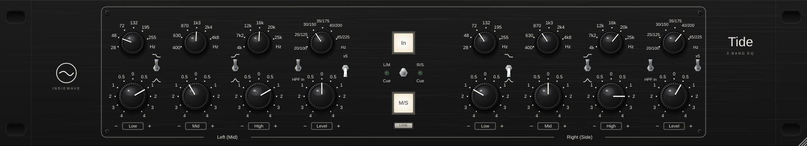

# TIDE — IndieWave Audio

A three band mastering and mix bus equaliser with mid/side. Two identical
halves, left and right or mid and side, each with a low band, a mid band and
a high band on stepped switches, a high pass and an output level. Smooth,
broad, Baxandall style curves: every band has a Q of 0.5, and every gain is a
switch, so a setting can be written down and recalled exactly.



Built with JUCE 8. Ships as **VST3** and **Standalone** on Windows, macOS and
Linux, plus **AU** on macOS. Zero latency.

---

## Controls

Per half (LEFT/MID on the left of the panel, RIGHT/SIDE on the right):

| Control | Positions | What it does |
| --- | --- | --- |
| **LOW** frequency | 28, 48, 72, 132, 195, 255 Hz | Where the low band sits. |
| **LOW** shelf/peak | toggle, up is shelf | Shelf: the legend is the middle of the slope, half the dB there, the full amount below. Peak: the full amount at the legend. |
| **LOW** gain | 0, ±0.5, ±1, ±2, ±3, ±4 dB | Cut or boost. |
| **MID** frequency | 400, 630, 870 Hz, 1.3, 2.4, 4.8 kHz | Always a peak. |
| **MID** gain | as above | |
| **HIGH** frequency | 4, 7.2, 12, 16, 20, 25 kHz | Where the high band sits. |
| **HIGH** shelf/peak | toggle, up is shelf | As for the low band, mirrored. |
| **HIGH** gain | as above | |
| **HPF** frequency | 20, 25, 30, 35, 40, 45 Hz | 12 dB/octave, Q 0.5: no bump, 6 dB down at the legend. |
| **HPF in** | toggle | Out is out: the filter is not in the path. |
| **x5** | toggle | Moves the high pass to 100 … 225 Hz. |
| **LEVEL** | 0, ±0.5, ±1, ±2, ±3, ±4 dB | Output level of the half. In M/S, the side level is the stereo width. |

Centre:

| Control | What it does |
| --- | --- |
| **In** | The EQ in or out. Out is the input, sample for sample, with a 20 ms fade on the switch. |
| **M/S** | The left half works on the mid, the right half on the side. |
| **Cue** | Left: the left channel (or the mid) on both outputs. Right: the right channel (or the side). Centre: off. The green lamp shows which. A monitoring aid; leave it centred when you render. |
| **LINK** | The left half drives both channels; the right half is dimmed and ignored. Not on the hardware: a convenience for stereo work. |

## M/S tips

* **Width.** In M/S, the right half's LEVEL is the side level. Down narrows
  the image, up widens it, the mid stays where it is.
* **Mono low end.** In M/S, switch in the right half's HPF: everything below
  its frequency is in mono. With x5, up to 225 Hz.
* **Air on the sides.** A high shelf on the right half lifts the top of the
  side signal only, without brightening the vocal, kick, snare and bass that
  sit in the middle.

## The curves

Every band is a second order section with Q 0.5, written so that a cut is the
exact reciprocal of the boost of the same size, the way a Baxandall band
behaves. Measured on the prototypes by the offline checks:

| | |
| --- | --- |
| Every peak at its legend | exactly its switch's dB |
| Every shelf at its legend | exactly half its switch's dB |
| Every shelf two decades past its legend | its switch's dB, within 0.01 dB |
| Cut against boost, 10 Hz to 40 kHz | mirror images |
| A +4 dB peak an octave either side | +2.55 dB: broad, as Q 0.5 should be |

### At a sample rate

A 25 kHz band still has to lift the top octave at 44.1 kHz, where the
bilinear transform would squash it against Nyquist. Tide does not oversample.
Each section is designed from its analogue prototype by mapping the poles
exactly and fitting the zeros to the analogue magnitude across the audio band,
the same design Hinge uses. From `tide_tests`, the worst deviation from the
prototype from 20 Hz to 20 kHz, over every band, shape, frequency and gain:

| Rate | Bands | High pass |
| --- | --- | --- |
| 44.1 kHz | 0.19 dB | 0.001 dB |
| 48 kHz | 0.12 dB | 0.001 dB |
| 96 kHz | 0.007 dB | 0.002 dB |

Measured through the plugin with sine tones at 48 kHz, five panel settings:
within 0.08 dB.

A band at 0 dB is not in the path at all, so a flat panel, in L/R or M/S, is
the input bit for bit. The filters run in double precision, every control is
smoothed, and shelf/peak, the high pass, In, M/S and cue all crossfade, so a
switch thrown under signal glides rather than clicks.

## What it is, and what it is not

The control set, switch positions, ranges and panel layout follow the TK Audio
TK-lizer 3, a three band mastering EQ with mid/side, as its published
specification describes it.

It is not that product, nor affiliated with TK Audio. No hardware was
measured; the curves are built from the specification. The name, the knobs
and the artwork are this project's own, all drawn in code, and no logo or
artwork of the hardware is used.

## Building

Requires CMake 3.22+ and a C++20 compiler.

```bash
cd plugins/tide
cmake -B build -DCMAKE_BUILD_TYPE=Release          # fetches JUCE 8.0.6
cmake --build build --parallel
```

On Linux, JUCE needs the usual development headers (see the Crest README).

### Offline checks and snapshot

```bash
cmake -B build -DTIDE_BUILD_TESTS=ON -DTIDE_BUILD_TOOLS=ON
cmake --build build --target tide_tests tide_shot --parallel
./build/tide_tests_artefacts/Release/tide_tests
./build/tide_shot_artefacts/Release/tide_shot docs/ui.png 1640
```

The checks assert: the prototypes against the specification (peaks, shelves,
mirror symmetry, Q, the high pass and x5), the digital filters against the
prototypes at 44.1 to 192 kHz, measured responses through the plugin, bit
exact nulls for a flat panel in L/R and M/S, for EQ out and for the host's
bypass, zero latency, M/S width and the mono low end, cue in both modes, link,
shelf to peak settling exactly, click free switching of every control at
random under a tone, finite output at full boost across rates and block
sizes, mono, and state surviving a save.

## Source

```
src/dsp/Bands.h          the switch tables and the analogue prototypes
src/dsp/MatchedDesign.h  analogue to digital: exact poles, fitted zeros; the biquad
src/dsp/ChannelEq.h      one channel: smoothing, the signal path
src/PluginProcessor.*    parameters, link, mid/side, In, cue
src/gui/Panel.*          bakelite knobs, toggles, lit buttons, all drawn in code
src/PluginEditor.*       the panel layout, scaled as a whole from one design size
tests/Tests.cpp          the offline checks
tools/Snapshot.cpp       offscreen editor render
```

## Licence

As for the rest of this repository; see `../../LICENSE` and `../../NOTICE.md`.
