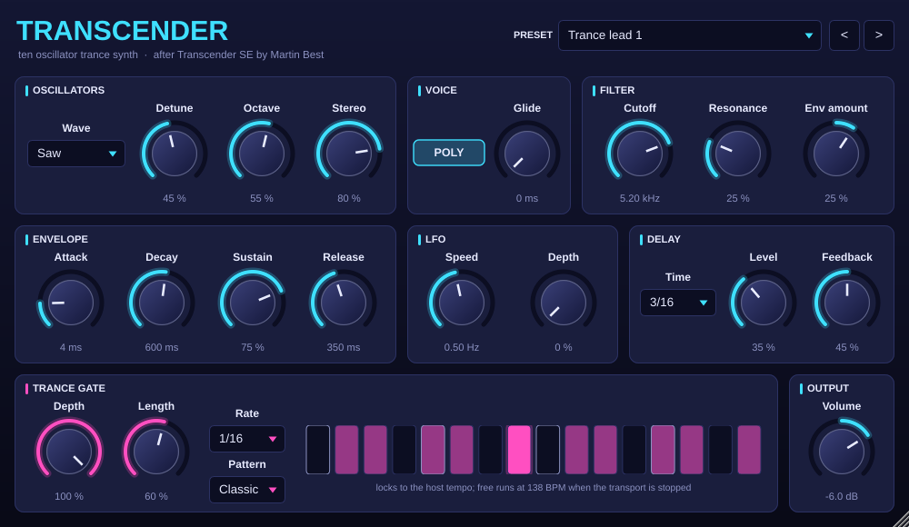

# TRANSCENDER — IndieWave Audio

A ten oscillator trance synth with a tempo locked gate and ping-pong delay.



Built with JUCE 8. Ships as **AU**, **VST3** and **Standalone** for macOS
(universal: Apple silicon and Intel) and **VST3** and **Standalone** for
64 bit Windows.

---

## Where it comes from

Transcender is a rebuild of **Transcender SE**, a free Windows VST instrument
made by Martin Best in SynthEdit in 2003. That plugin is a 32 bit Windows DLL
and cannot load in any current Mac host. A SynthEdit export cannot be
recompiled, so this is a new engine. It keeps what the original's embedded
patch shows about the instrument:

- five oscillators round the played pitch and five more an octave above
  ("Oscillator 1–5" and "A–E"), with **Detune**, **Dual octave**,
  **Stereo** spread and a **Waveform** switch
- a state variable low pass filter with **Cutoff** and **Resonance**, driven
  by the same ADSR as the amplifier
- an **LFO** with **Speed** and **Depth** on the filter
- **Poly / Mono** and **Glide**
- a **Trance gate** run from a BPM clock and a step counter
- a stereo delay whose two sides are set 1 : 2 apart (0.75 and 1.5 in the
  original), with **Level** and **Feedback**
- the sixteen factory program names, from *Trance lead 1* to *Tinkabell*

The sound is not a sample-for-sample copy: the presets are new settings
under the original names, and the gate and delay lock to the host's tempo.

## Controls

| Section | Control | What it does |
| --- | --- | --- |
| Oscillators | **Wave** | Saw, square, triangle or sine for all ten oscillators. |
| | **Detune** | How far the oscillators spread round the pitch, up to ±50 cents for the outer pair. |
| | **Octave** | Level of the upper bank, an octave up. |
| | **Stereo** | Spreads the oscillators across the stereo field. 0 is mono. |
| Voice | **Poly / Mono** | Eight voice polyphony, or one legato voice with last-note priority. |
| | **Glide** | Portamento time. In poly mode a new note glides from the last one played. |
| Filter | **Cutoff**, **Resonance** | 12 dB/oct low pass, half key tracked. |
| | **Env amount** | How far the envelope moves the cutoff, up or down, up to 6 octaves. |
| Envelope | **Attack**, **Decay**, **Sustain**, **Release** | One envelope for both level and filter. |
| LFO | **Speed**, **Depth** | Sine LFO on the cutoff, up to ±3 octaves. The mod wheel adds depth. |
| Delay | **Time** | 1/16 to 1/2 note at the host tempo. The right side repeats at twice the left's time. |
| | **Level**, **Feedback** | Echo level and how long the echoes last. |
| Trance gate | **Depth** | 0 is off; 100 % closes fully between steps. |
| | **Length** | How much of each "on" step stays open. |
| | **Rate**, **Pattern** | Step size (1/8, 1/16, 1/32) and one of ten 16 step patterns. The lights show the pattern and the step playing. |
| Output | **Volume** | Output level. |

MIDI: pitch bend (±2 semitones), mod wheel (LFO depth), sustain pedal and
all-notes-off. Every control can be automated from the host.

The gate and delay follow the host's tempo and bar position. When the
transport is stopped, or in the standalone app, they free run at 138 BPM.

## Install on a Mac

1. Download `Transcender-<version>-macOS.zip` from the releases page (or the
   `transcender-latest` pre-release) and unzip it.
2. Copy:
   - `Transcender.component` to `~/Library/Audio/Plug-Ins/Components/`
     (Logic Pro, GarageBand, Ableton Live, and other AU hosts)
   - `Transcender.vst3` to `~/Library/Audio/Plug-Ins/VST3/`
     (Ableton Live, Cubase, Reaper, Bitwig, FL Studio, …)
   - `Transcender.app` to `/Applications/` if you want the standalone version.
3. The plugin is signed ad hoc, not by a registered Apple developer, so macOS
   blocks it the first time. Run this once in Terminal, then restart the host:

   ```bash
   xattr -dr com.apple.quarantine ~/Library/Audio/Plug-Ins/Components/Transcender.component ~/Library/Audio/Plug-Ins/VST3/Transcender.vst3
   ```

   Logic and GarageBand may need a rescan: open Logic's Plug-in Manager and
   choose *Reset & Rescan Selection*.

Transcender appears as an instrument (Audio Units → IndieWave Audio →
Transcender).

## Building

```bash
cd plugins/transcender
cmake -B build -DCMAKE_BUILD_TYPE=Release -DCMAKE_OSX_ARCHITECTURES="arm64;x86_64" -DTRANSCENDER_BUILD_TESTS=ON
cmake --build build --parallel
./build/transcender_tests_artefacts/Release/transcender_tests
```

The plugins land in `build/Transcender_artefacts/Release/`. CMake fetches
JUCE 8.0.6 unless `-DJUCE_PATH=` points at a local copy.
`-DTRANSCENDER_BUILD_TOOLS=ON` builds `transcender_shot`, which renders the
editor to a PNG.
